# 👷‍♂️ How to build your own examples or reproduction models with reusables

Below is a collection of *how to* that you can re-use when you build your own examples or reproduction models.

## 🛠 Bootstrap reproduction model

Execute [🧠 CLI](/cli) with `playground repro bootstrap` [command](/playground%20repro%20bootstrap). It will start in interactive mode.

Examples:

### Basic

<script async id="asciicast-646555" src="https://asciinema.org/a/646555.js"></script>

### Deprecated: Java producer (`--producer`)

> [!WARNING]
> Most of times, it's much simpler to use `playground topic produce` [CLI](/playground%20topic%20produce)
> 
> Use java producer only if you have very specific requirements such as specifying record timestamp
> See [here](/legacy-java-producer) for instructions


### With custom SMT (`--custom-smt`)

If you want to add a custom SMT, just add `--custom-smt` flag.

This will create the following files:

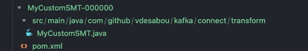

This is a no-op custom SMT:

```java
    @Override
    public R apply(R record) {
        log.info("Applying no-op MyCustomSMT");
        // add your logic here
        return record.newRecord(
            record.topic(),
            record.kafkaPartition(),
            record.keySchema(),
            record.key(),
            record.valueSchema(),
            record.value(),
            record.timestamp()
        );
    }
```

It will also add the required steps to compile code:

```bash
for component in MyCustomSMT-000000
do
    set +e
    log "🏗 Building jar for ${component}"
    build_java_component_with_retry "${component}" docker run -i --rm -e KAFKA_CLIENT_TAG=$KAFKA_CLIENT_TAG -e TAG=$TAG_BASE -v "${DIR}/${component}":/usr/src/mymaven -v "$HOME/.m2":/root/.m2 -v "$PWD/../../scripts/settings.xml:/tmp/settings.xml" -v "${DIR}/${component}/target:/usr/src/mymaven/target" -w /usr/src/mymaven maven:3.9.11-eclipse-temurin-17 mvn -s /tmp/settings.xml -Dkafka.tag=$TAG -Dkafka.client.tag=$KAFKA_CLIENT_TAG package
    set -e
done
```

It will copy the jar to the connector lib folder:

```bash
log "📂 Copying custom jar to connector folder /usr/share/confluent-hub-components/debezium-debezium-connector-sqlserver/lib/"
playground container cp --source /path/to/kafka-docker-playground/reproduction-models/connect-connect-debezium-sqlserver-source/MyCustomSMT-000000/target/MyCustomSMT-1.0.0-SNAPSHOT-jar-with-dependencies.jar --destination connect:/usr/share/confluent-hub-components/debezium-debezium-connector-sqlserver/lib/
log "📂 Copying custom jar to connector folder /usr/share/confluent-hub-components/confluentinc-connect-transforms/lib/"
playground container cp --source /path/to/kafka-docker-playground/reproduction-models/connect-connect-debezium-sqlserver-source/MyCustomSMT-000000/target/MyCustomSMT-1.0.0-SNAPSHOT-jar-with-dependencies.jar --destination connect:/usr/share/confluent-hub-components/confluentinc-connect-transforms/lib/
log "♻️ Restart connect worker to load"
playground container restart --container connect
```

And add the transform config to connector:

```json
  "transforms": "MyCustomSMT",
  "transforms.MyCustomSMT.type": "com.github.vdesabou.kafka.connect.transforms.MyCustomSMT",
```

> [!TIP]
> To try the SMT on a record without copying the jar and restarting the worker after each build, use [playground connector smt test](/reusables?id=%f0%9f%a7%aa-testing-smts) with `--smt-jar`:
> `playground connector smt test --connector <connector> --smt-jar MyCustomSMT-000000/target/MyCustomSMT-1.0.0-SNAPSHOT-jar-with-dependencies.jar`

### With pipeline (`--pipeline`)

All the steps to create a pipeline, i.e an example with source and sink connectors are automated:

Example:

<script async id="asciicast-646556" src="https://asciinema.org/a/646556.js"></script>

It will automatically:

* Add sink example(s) (you can select multiple !) at the end of source example
* Modify sink converters (key and value) to use same as source example
* Use same kafka topic for all connectors
* Add all required containers for all sink and source
* Update `CONNECT_PLUGIN_PATH` to include all connectors

## 👉 Producing data

Use [playground topic produce](/playground%20topic%20produce): it creates the topic if needed, registers the schema (avro, json schema or protobuf) and generates realistic random data matching it. See the [command page](/playground%20topic%20produce) for all options.

> [!TIP]
> Pipe the schema or the payload with a quoted heredoc, `<< 'EOF'`, so that the `%g` placeholders survive the shell.

<!-- tabs:start -->

#### **String**

```bash
playground topic produce -t a-topic --nb-messages 10 --forced-value "This is a message %g"
```

#### **JSON**

```bash
playground topic produce -t a-topic --nb-messages 3 << 'EOF'
{"u_name": "scissors", "u_price": 2.75, "u_quantity": 3}
{"u_name": "tape", "u_price": 0.99, "u_quantity": 10}
{"u_name": "notebooks", "u_price": 1.99, "u_quantity": 5}
EOF
```

#### **Key and headers**

```bash
# key1, key2, etc.. (%g can also be used)
playground topic produce -t a-topic --nb-messages 3 --key "key1" --headers "header1:value1,header2:value2" << 'EOF'
{"u_name": "scissors", "u_price": 2.75, "u_quantity": 3}
{"u_name": "tape", "u_price": 0.99, "u_quantity": 10}
{"u_name": "notebooks", "u_price": 1.99, "u_quantity": 5}
EOF
```

#### **Avro**

```bash
playground topic produce -t a-topic --nb-messages 10 << 'EOF'
{
  "type": "record",
  "name": "myrecord",
  "fields": [
    {"name": "u_name", "type": "string"},
    {"name": "u_price", "type": "float"},
    {"name": "u_quantity", "type": "int"}
  ]
}
EOF
```

#### **Avro with key**

```bash
playground topic produce -t a-topic --nb-messages 10 --key '
{
  "type": "record",
  "name": "myrecordkey",
  "fields": [
    {"name": "ID", "type": "long"}
  ]
}
' << 'EOF'
{
  "type": "record",
  "name": "myrecordvalue",
  "fields": [
    {"name": "ID", "type": "long"},
    {"name": "product", "type": "string"},
    {"name": "quantity", "type": "int"},
    {"name": "price", "type": "float"}
  ]
}
EOF
```

#### **Protobuf**

```bash
playground topic produce -t a-topic --nb-messages 10 << 'EOF'
syntax = "proto3";

message MyRecord {
    string f1 = 1;
}
EOF
```

#### **JSON Schema**

```bash
playground topic produce -t a-topic --nb-messages 10 << 'EOF'
{
  "type": "object",
  "properties": {
    "f1": {"type": "string"}
  }
}
EOF
```

#### **Exact payload**

Use `--generate-only` first to get the skeleton of a message, then `--forced-value` to send exactly the record you need:

```bash
playground topic produce -t a-topic --nb-messages 1 --forced-value '{"f1": "value1"}' << 'EOF'
{
  "type": "record",
  "name": "myrecord",
  "fields": [
    {"name": "f1", "type": "string"}
  ]
}
EOF
```

#### **Schema file**

```bash
playground topic produce -t a-topic --nb-messages 10 < schema.avsc
```

#### **Tombstone**

```bash
playground topic produce -t a-topic --tombstone --key "mykey1"
```

#### **High volume**

```bash
playground topic produce -t a-topic --nb-messages 200000 --record-size 1000
```

<!-- tabs:end -->

> [!NOTE]
> The [Java producers](/legacy-java-producer) are deprecated: use them only if you have very specific requirements, such as setting the record timestamp.

## 👉 Consuming data

Use [playground topic consume](/playground%20topic%20consume): it reads the topic from the beginning and detects the format (avro, protobuf, json schema or plain) on its own. Every record is displayed with its timestamp, partition, offset, headers, key and schema ID.

<!-- tabs:start -->

#### **Simplest**

```bash
playground topic consume --topic a-topic
```

#### **All topics**

```bash
playground topic consume
```

#### **Assert content**

Wait up to `--timeout` seconds for at least 10 records containing `value1`, and fail otherwise (this is how examples verify that data flowed):

```bash
playground topic consume --topic a-topic --min-expected-messages 10 --grep "value1" --timeout 60
```

#### **Tail**

```bash
playground topic consume --topic a-topic --tail
```

#### **Open in editor**

```bash
playground topic consume --topic a-topic --open
```

<!-- tabs:end -->

## 🧪 Testing SMTs

[playground connector smt test](https://kafka-docker-playground.io/#/playground%20connector%20smt%20test) runs a chain of Single Message Transforms (SMTs) on one record and shows what each transform does to it, in a few seconds. No topic or connector is created, and the connector is not updated. You see, step by step:

* what changes: topic, partition, timestamp, key, headers (with their types), the value field by field, and the schema
* each predicate and its result, including `negate`: a skipped transform is shown as skipped
* a dropped record (a transform returned `null`, for example `Filter`)
* the transform that fails, with its config and its error (`--verbose` adds the stack trace)
* where each transform class comes from (`from`): the plugin and its version, or the Kafka version of the worker. A warning appears when another copy of the class is on the plugin path

The chain runs in a small harness inside the `connect` container, with the classpath and the `plugin.path` of the worker. The transforms, predicates and converters are the same classes and versions as in the worker.

```bash
# the transforms of a running connector, on a default record
playground connector smt test --connector filestream-sink

# the same transforms, on a real record of the topic (converted with the converters of the connector: avro, protobuf, json schema...)
playground connector smt test --connector filestream-sink --from-topic filestream --offset 0

# your own chain on stdin (a whole connector config works too: only transforms.*, predicates.* and the converters are used)
playground connector smt test --record '{"topic":"orders","key":"o-1","value":{"id":1}}' << 'EOF'
{
  "transforms": "route",
  "transforms.route.type": "org.apache.kafka.connect.transforms.RegexRouter",
  "transforms.route.regex": "(.*)",
  "transforms.route.replacement": "crm-$1"
}
EOF

# the transforms and the record in files
playground connector smt test --config @transforms.json --record @record.json
```

> [!TIP]
> The [connect-testing-smt-filestream-sink](https://github.com/vdesabou/kafka-docker-playground/tree/master/connect/connect-testing-smt-filestream-sink) example shows every way to use the command, with a ready-to-use record and chain: `playground run -f testing-smt.sh`

### The record

`--record` is a JSON object (or `@file`), all fields optional. Without it, the record is `{"topic": <first topic of the connector or test-topic>, "key": "k1", "value": {"id": 1, "name": "foo"}}`.

| Field | Content |
| --- | --- |
| `topic`, `partition`, `offset`, `timestamp` | where the record comes from |
| `key`, `value` | schemaless JSON, `null` for a tombstone, or the `{"schema": ..., "payload": ...}` envelope of the `JsonConverter` for a value with a schema (a `Struct`) |
| `headers` | an object (`{"source": "crm", "retries": 3}`), or an array to repeat a key (`[{"key": "trace", "value": "a"}, {"key": "trace", "value": "b"}]`). Types follow the JSON value: `STRING`, `BOOLEAN`, `INT64`, `FLOAT64`, schemaless for an object |

A value with a schema:

```json
{
  "topic": "customers",
  "key": "c-42",
  "value": {
    "schema": {
      "type": "struct",
      "name": "Customer",
      "fields": [
        { "field": "customer_id", "type": "string" },
        { "field": "email", "type": "string" }
      ]
    },
    "payload": { "customer_id": "42", "email": "john@example.com" }
  },
  "headers": { "source": "crm" }
}
```

To test a real record instead, use `--from-topic <topic> --offset <n> [--partition <p>]`. The record is read from Kafka and converted with the key, value and header converters of the connector (or of the worker), with Schema Registry when they use it.

The record is a `SinkRecord` by default. Use `--type source` for the transforms of a source connector: some transforms only accept one kind of record. For example, `InsertField` with `offset.field` fails on a source record with `Only SinkRecord supported for [field insertion]`, as in a real source connector.

### The result

The terminal shows one block per step (✅ applied, ⏭️ skipped by its predicate, ➖ no change, 🗑️ dropped, ❌ failed), then the final record. An HTML report is also written to `/tmp/playground-smt-test/`, and opened in the browser when the command runs in an interactive terminal (`--no-open` to only write it). The report contains:

* the chain at the top, one badge per step
* one card per step: class, origin, config, predicate, then the topic, key, header and value changes (added, changed, removed), and the schema diff
* the error and its stack trace for a failing step
* a final record card: what the sink connector receives, or what the source connector sends to Kafka

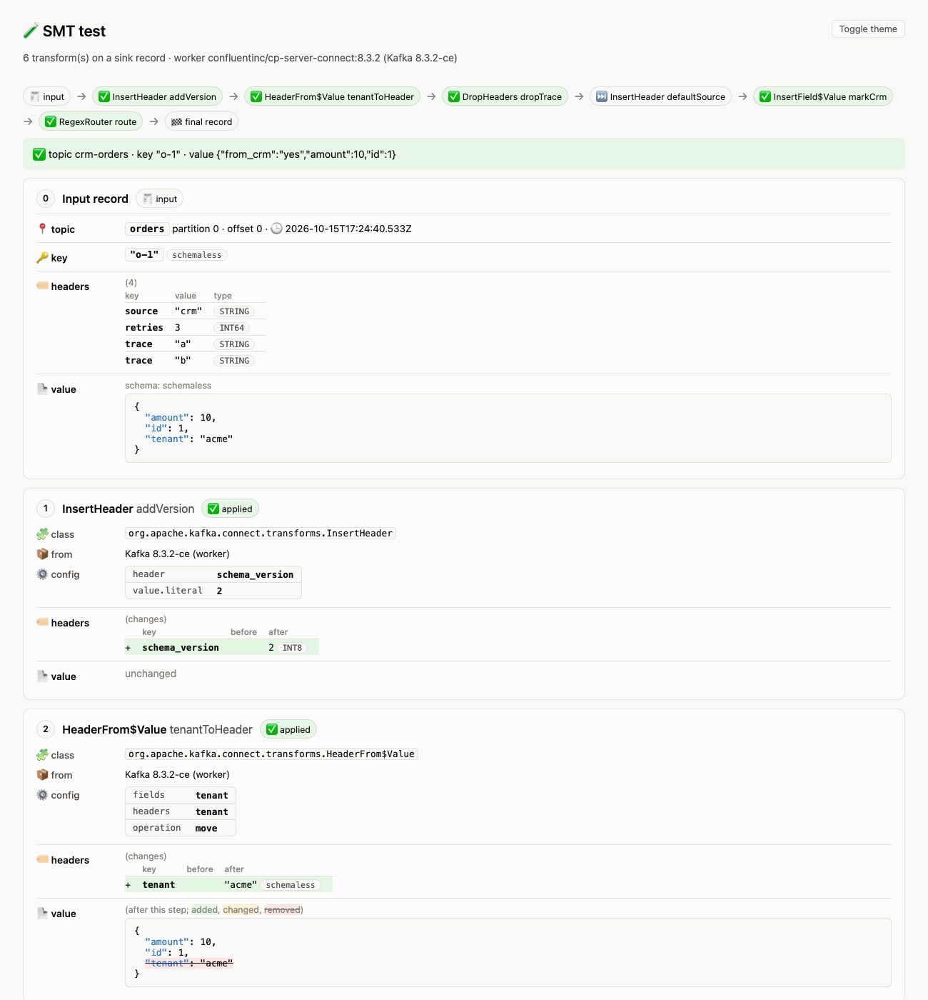

With `--json`, the steps are printed as JSON for scripts. The command exits with `1` when a transform fails (a dropped record is not an error):

```bash
playground connector smt test --json --config @transforms.json --record @record.json \
  | jq -e '[.steps[] | select(.record)] | last | .record.value | fromjson | .email_address == "john@example.com"'
```

### Another CP version

`--cp-version` (repeat the flag) runs the same chain in throwaway `cp-server-connect` containers of those versions, to see whether an upgrade changes what the transforms do. The summary and the report compare the final record of each version. It also works without a running example, with `--config`:

```bash
playground connector smt test --connector filestream-sink --from-topic filestream --offset 0 --cp-version 7.9.0 --cp-version 8.3.2
```

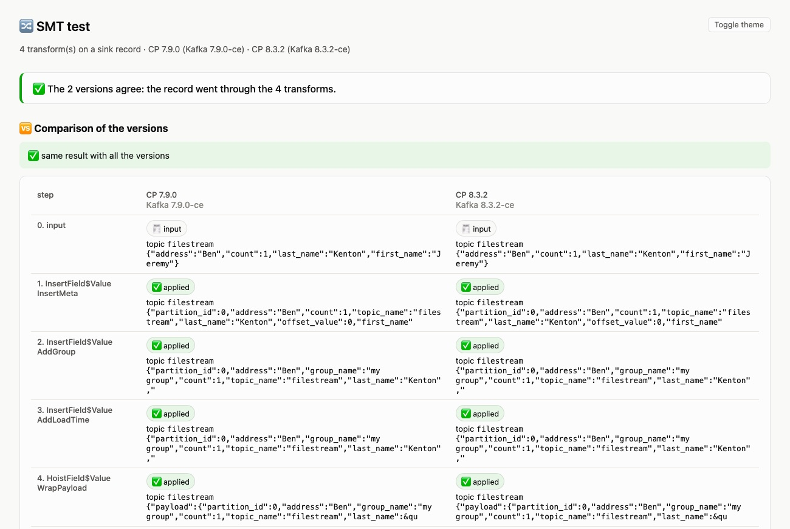

### SMTs that are not in the worker

The SMTs shipped with Kafka and the plugins on the `plugin.path` of the worker are available. To test others, without changing the worker:

```bash
# a Confluent Hub plugin (or another version than the one installed), installed for the test only and cached in ~/.playground-smt-tester
playground connector smt test --connector my-sink --smt-plugin confluentinc/connect-transforms:1.4.4

# your own build: repeat --smt-jar for the jars it depends on, they are loaded together as one plugin
playground connector smt test --config @transforms.json --smt-jar target/my-smt-1.0.0.jar --smt-jar lib/its-dependency.jar
```

These plugins take precedence over a copy of the same transform on the plugin path of the worker.

> [!NOTE]
> Self-managed connectors only: the transforms of a fully managed connector run in Confluent Cloud (give its config with `--config` for an indicative result on a self-managed worker). The cfk environment is not supported yet. The chain runs outside of a connector task, so `errors.tolerance` and the dead letter queue do not apply: a failing transform is reported as failing.

## 🧙 How to install other connectors

Simplest option is to create a reproduction model with `playground repro bootstrap` [command](/playground%20repro%20bootstrap) and then select "🔌 Add connector plugin" (you can call it multiple times to add multiple connector plugins/SMT) 


it has interactive selection from confluent hub:


It will automatically add the plugin(s) to the list of `CONNECT_PLUGIN_PATH`:

Example with S3 source and S3 sink:

```yml
services:
  connect:
    environment:
      CONNECT_PLUGIN_PATH: /usr/share/confluent-hub-components/confluentinc-kafka-connect-s3-source,/usr/share/confluent-hub-components/confluentinc-kafka-connect-s3
```

Example with [confluentinc/connect-transforms](https://www.confluent.io/hub/confluentinc/connect-transforms) SMT:

```yml
services:
  connect:
    environment:
      CONNECT_PLUGIN_PATH: /usr/share/confluent-hub-components/confluentinc-kafka-connect-s3-source,/usr/share/confluent-hub-components/confluentinc-connect-transforms
```

It can also be done non-interactively with `--connector-plugin` (repeatable):

```bash
playground repro bootstrap -f s3-sink<tab> --description "s3 sink with transforms" --connector-plugin confluentinc/connect-transforms
```

> [!TIP]
> You can also specify versions when specifying multiple connector/SMT, see [here](https://kafka-docker-playground.io/#/how-to-use?id=%f0%9f%94%97-for-connectors).


## 🐛 Debugging tools

### ✨ Remote debugging

Java Remote debugging is the perfect tool for troubleshooting Kafka connectors for example.

> [!TIP]
> Following are instructions for [Visual Studio Code ](https://code.visualstudio.com/docs/java/java-debugging), but it is exactly the same principle for [IntelliJ IDEA](https://www.jetbrains.com/help/idea/tutorial-remote-debug.html#436b3b68).

#### ☑️ Prerequisites

Make sure you have already the required Visual Studio code extensions by following [this](https://code.visualstudio.com/docs/java/java-debugging#_install).

#### 💫 Full example

Here is a full example using [HDFS 2 sink](https://github.com/vdesabou/kafka-docker-playground/tree/master/connect/connect-hdfs2-sink) connector and [Visual Studio Code ](https://code.visualstudio.com/docs/java/java-debugging):

1. Launch the example as usual, i.e start `./hdfs2-sink.sh`.

2. Clone and open [`confluentinc/kafka-connect-hdfs`](https://github.com/confluentinc/kafka-connect-hdfs) repository in Visual Studio Code.

3. Switch to the branch corresponding to the connector version you're going to run. 
 
In this example, the connector version is `10.1.1`, so switch to branch tag `v10.1.1` (use the version you are actually running, see `playground connector versions`):

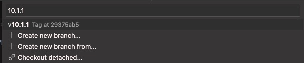

4. Remote debugging is enabled by default on the `connect` container (port `5005`), so there is nothing to do for connectors.

For other containers (for example `broker` or `schema-registry`), use [🧠 CLI](/cli) with `enable-remote-debugging` [command](/playground%20debug%20enable-remote-debugging):

```bash
$ playground debug enable-remote-debugging -c broker
```

It sets `KAFKA_DEBUG` and `JAVA_DEBUG_OPTS` environment variables on the container (using `playground container set-environment-variables`) and displays the configuration to add in `.vscode/launch.json`.

5. [Configure](https://code.visualstudio.com/docs/java/java-debugging#_configure) remote debugging by clicking on menu `Run`->`Add Configuration...`:


Then copy/paste the following entry:

```json
{
    "type": "java",
    "name": "Debug connect container",
    "request": "attach",
    "hostName": "127.0.0.1",
    "port": 5005,
    "timeout": 30000
}
```

Note: you can also directly edit file `.vscode/launch.json`:

```json
{
    "version": "0.2.0",
    "configurations": [
    
        {
            "type": "java",
            "name": "Debug connect container",
            "request": "attach",
            "hostName": "127.0.0.1",
            "port": 5005,
            "timeout": 30000
        }
    ]
}
```

*Example:*

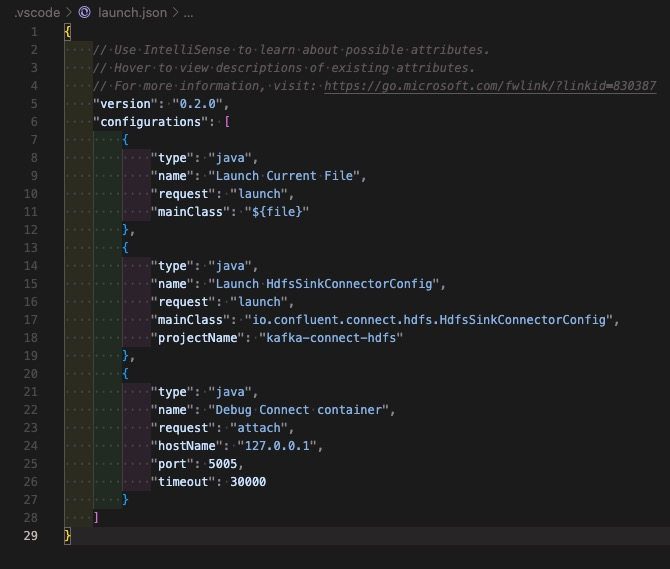

6. Go in `Run and Debug` and make sure to select the `Debug connect container` config:

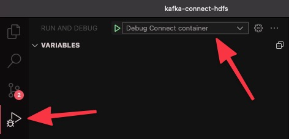

7. Click on the green play button


8. Add breakpoint(s) where you want, for example [here](https://github.com/confluentinc/kafka-connect-hdfs/blob/9a5e68d7294a79c40050efd7b51d7428c7f7c4d5/src/main/java/io/confluent/connect/hdfs/TopicPartitionWriter.java#L894):

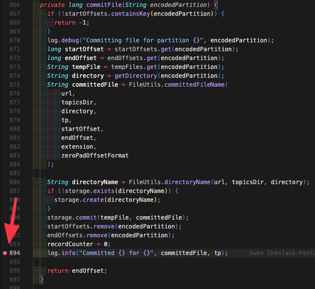

9. Process some messages:

```bash
playground topic produce -t test_hdfs --nb-messages 10 << 'EOF'
{
  "type": "record",
  "name": "myrecord",
  "fields": [
    {"name": "f1", "type": "string"}
  ]
}
EOF
```

10. See results 🍿:

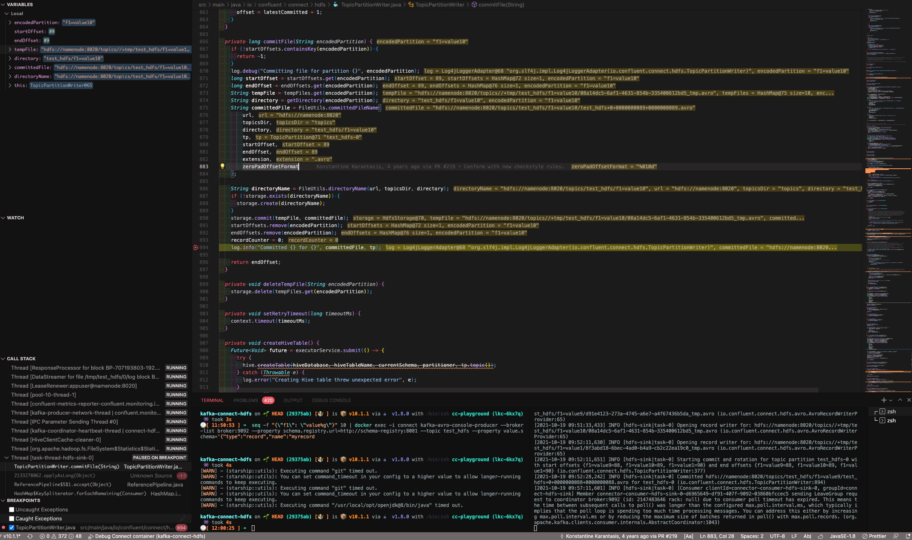


Note (*for Confluent employees because control center code is proprietary*): for `control-center`, you can use following override (note the `5006` port in order to avoid clash with `connect` port):

```yml
  control-center:
    ports:
      - "9021:9021"
      - "5006:5006"
    environment:
      CONTROL_CENTER_OPTS: "-agentlib:jdwp=transport=dt_socket,server=y,suspend=n,address=0.0.0.0:5006"
```

### 🔗 Connectors

In order to enable `TRACE`(or `DEBUG`) logs for connectors, use the `admin/loggers` endpoint (see docs [here](https://docs.confluent.io/platform/current/connect/logging.html#change-the-log-level-for-a-specific-logger)):

*Example:*

```bash
curl --request PUT \
  --url http://localhost:8083/admin/loggers/io.confluent.connect.oracle.cdc \
  --header 'Accept: application/json' \
  --header 'Content-Type: application/json' \
  --data '{
	"level": "TRACE"
}'
```

> [!WARNING]
> Make sure to update `io.confluent.connect.oracle.cdc` above with the package you want to troubleshoot.

Useful packages:

* `io.confluent.kafka.schemaregistry.client.rest.RestService`: to track schema registry requests
* `org.apache.kafka.connect.runtime.TransformationChain`: to see records before, during and after SMT

Or just use [CLI](/playground%20connector%20log-level) `playground connector log-level` 

To have the levels set before the example creates its connector (so that the first lines are already at `TRACE`), use `--connect-log-level` option of [playground run](/playground%20run), with the same syntax as `CONNECT_LOG4J_LOGGERS` (levels `INFO`, `WARN`, `DEBUG` or `TRACE`). In the menu, 🔊 Connect log level(s) suggests the packages of the example's connector:

```bash
playground run -f s3-sink<tab> --connect-log-level "io.confluent.connect.s3=TRACE,org.apache.kafka.connect.runtime.WorkerSinkTask=DEBUG"
```

Example:

```bash
playground connector log-level --level TRACE
```

### 🔑 SSL debug

> [!NOTE]
> The default `connect` service already sets `KAFKA_OPTS: -Ddynamic.worker.config.file=/dev/null` (see [`environment/plaintext/docker-compose.yml`](https://github.com/vdesabou/kafka-docker-playground/blob/master/environment/plaintext/docker-compose.yml)), so keep it when you override `KAFKA_OPTS` in the snippets below.

Add `-Djavax.net.debug=all` in your `docker-compose` file:

*Example:*

```yml
  connect:
    environment:
      KAFKA_OPTS: -Ddynamic.worker.config.file=/dev/null -Djavax.net.debug=all
```

Use `-Djavax.net.debug=ssl:handshake` instead of `-Djavax.net.debug=all` to only see the handshake.

Or just use [CLI](/playground%20debug%20java-debug) `playground debug java-debug` with `--type ssl_all` or `--type ssl_handshake`.

### 🔒 Kerberos debug

Add `-Dsun.security.krb5.debug=true` in your `docker-compose` file:

*Example:*

```yml
  connect:
    environment:
      KAFKA_OPTS: -Ddynamic.worker.config.file=/dev/null -Dsun.security.krb5.debug=true
```

Or just use [CLI](/playground%20debug%20java-debug) `playground debug java-debug` with `--type kerberos`.

### 🔬 Class loading

Add `-verbose:class` in your `docker-compose` file to troubleshoot a `ClassNotFoundException` for example:

*Example:*

```yml
  connect:
    environment:
      KAFKA_OPTS: -Ddynamic.worker.config.file=/dev/null -verbose:class
```

Or just use [CLI](/playground%20debug%20java-debug) `playground debug java-debug` with `--type class_loading`.

In logs, you'll see:

```log
[Loaded org.apache.kafka.connect.runtime.isolation.DelegatingClassLoader$$Lambda$20/1007251739 from org.apache.kafka.connect.runtime.isolation.DelegatingClassLoader]
[Loaded java.lang.invoke.LambdaForm$MH/1556595366 from java.lang.invoke.LambdaForm]
[Loaded org.reflections.util.ConfigurationBuilder from file:/usr/share/java/kafka/reflections-0.9.12.jar]
[Loaded org.reflections.serializers.Serializer from file:/usr/share/java/kafka/reflections-0.9.12.jar]
[Loaded org.reflections.adapters.MetadataAdapter from file:/usr/share/java/kafka/reflections-0.9.12.jar]
[Loaded org.reflections.scanners.Scanner from file:/usr/share/java/kafka/reflections-0.9.12.jar]
[Loaded org.reflections.scanners.AbstractScanner from file:/usr/share/java/kafka/reflections-0.9.12.jar]
[Loaded org.reflections.scanners.TypeAnnotationsScanner from file:/usr/share/java/kafka/reflections-0.9.12.jar]
[Loaded org.reflections.scanners.AbstractScanner$$Lambda$21/1725097945 from org.reflections.scanners.AbstractScanner]
[Loaded org.reflections.scanners.SubTypesScanner from file:/usr/share/java/kafka/reflections-0.9.12.jar]
[Loaded org.reflections.util.FilterBuilder from file:/usr/share/java/kafka/reflections-0.9.12.jar]
[Loaded org.reflections.util.FilterBuilder$Matcher from file:/usr/share/java/kafka/reflections-0.9.12.jar]
```

### 🕸️ Debug ServiceNow or Salesforce

Those connectors use low level [com.google.api.client.http](https://developers.google.com/api-client-library/java) library.

In order to activate debug logs to see requests/responses, you can just add the `volumes` mount with existing `../../connect/connect-servicenow-source/nginx-proxy/logging.properties` file and add `KAFKA_OPTS: -Djava.util.logging.config.file=/tmp/logging.properties`:

Example:

```yml
  connect:
    volumes:
      - ../../connect/connect-servicenow-source/nginx-proxy/logging.properties:/tmp/logging.properties
    environment:
      KAFKA_OPTS: -Ddynamic.worker.config.file=/dev/null -Djava.util.logging.config.file=/tmp/logging.properties
```

This is how the `logging.properties` looks like:

```bash
$ cat /tmp/logging.properties
handlers=java.util.logging.ConsoleHandler
java.util.logging.ConsoleHandler.level=ALL
com.google.api.client.http.level=ALL
```

### 🌍 Debug HTTP sink

This connector uses low level [Apache HTTP client](https://hc.apache.org/httpcomponents-client-5.2.x/) library.

In order to activate debug logs to see requests/responses, you can add `jcl-over-slf4j-2.0.7.jar` to the connector `lib` folder before starting the environment.

Example (from [`http_basic_auth.sh`](https://github.com/vdesabou/kafka-docker-playground/blob/master/connect/connect-http-sink/http_basic_auth.sh)):

```bash
cd ../../connect/connect-http-sink/
if [ ! -f jcl-over-slf4j-2.0.7.jar ]
then
     wget -q https://repo1.maven.org/maven2/org/slf4j/jcl-over-slf4j/2.0.7/jcl-over-slf4j-2.0.7.jar
fi
mkdir -p ../../confluent-hub/confluentinc-kafka-connect-http/lib/
cp jcl-over-slf4j-2.0.7.jar ../../confluent-hub/confluentinc-kafka-connect-http/lib/jcl-over-slf4j-2.0.7.jar
cd -
```

> [!NOTE]
> It is already set in all HTTP sink examples.

Then you can enable TRACE logs on `org.apache.http`:

```bash
$ playground debug log-level set --package "org.apache.http" --level TRACE
```

or legacy way:

```bash
curl --request PUT \
  --url http://localhost:8083/admin/loggers/org.apache.http \
  --header 'Accept: application/json' \
  --header 'Content-Type: application/json' \
  --data '{
 "level": "TRACE"
}'
```

### 🕵️‍♂️ See TLS traffic with mitmproxy

[mitmproxy](https://github.com/mitmproxy/mitmproxy) 

1. Add `mitmproxy` container in your `docker-compose` file:

```yml
  mitmproxy:
    image: mitmproxy/mitmproxy
    hostname: mitmproxy
    container_name: mitmproxy
    command: mitmdump --flow-detail 4
    ports:
      - "8080:8080"
    volumes:
      - $HOME/.mitmproxy:/home/mitmproxy/.mitmproxy
```

2. Add in your script after all containers are started:

```bash
playground container cp --source $HOME/.mitmproxy/mitmproxy-ca-cert.pem --destination connect:/tmp/mitmproxy-ca-cert.pem
playground container exec -c connect --root --command "cat /tmp/mitmproxy-ca-cert.pem >> /etc/ssl/certs/ca-bundle.crt"
playground container exec -c connect --root --command "keytool -importcert --cacerts -storepass changeit -noprompt -alias mitmproxy -file /tmp/mitmproxy-ca-cert.pem"
```

3. Use mitmproxy proxy in your connector config:

Example:

```json
"proxy.url": "mitmproxy:8080"
```

4. Check TLS traffic in clear text by checking logs of `mitmproxy` container

```bash
playground container logs -c mitmproxy

or

playground container logs --open --container mitmproxy
```

### 🕵 TCP Dump

When logs are not enough to understand a connectivity problem (connection resets, timeouts, TLS handshake failures, a client talking to the wrong host or port, unexpected retries…), capturing the network traffic of a container shows exactly what goes over the wire.

Just use [CLI](/playground%20debug%20tcp-dump) `playground debug tcp-dump`. It installs `tcpdump` in the container if needed, captures the traffic for `--duration` seconds (default 30, all ports unless `--port` is set), copies the resulting `.pcap` file to the current directory and opens it with [Wireshark](https://www.wireshark.org/) if it is installed. Start it, then reproduce the issue while the capture is running.

> [!NOTE]
> On an encrypted listener (SSL, SASL_SSL) you will see the TCP connections and the TLS handshake, but not the content of the requests. To read HTTPS traffic in clear text, use [mitmproxy](/reusables?id=%f0%9f%95%b5%ef%b8%8f%e2%80%8d%e2%99%82%ef%b8%8f-see-tls-traffic-with-mitmproxy) instead.

```bash
playground debug tcp-dump --container control-center --port 9021 --duration 60
```

### 👻 Heap Dump

A [heap dump](https://www.baeldung.com/java-heap-dump-capture) is a snapshot of all the objects in the JVM memory. Take one when a component uses more and more memory, spends its time in garbage collection or fails with `java.lang.OutOfMemoryError`, to find which objects (and which connector, task or client) hold the memory.

Just use [CLI](/playground%20debug%20heap-dump) `playground debug heap-dump`. It saves output to a `.hprof` file that can be read with [VisualVM](https://visualvm.github.io/) or [MAT](https://www.eclipse.org/mat/), or analyzed with [`playground analyze heap-dump`](/playground%20analyze%20heap-dump) (Eclipse MAT leak suspects, see [Analyze what you collected](/reusables?id=%f0%9f%94%8e-analyze-what-you-collected)).

```bash
playground debug heap-dump
playground debug heap-dump -c connect -c broker
playground debug heap-dump --container schema-registry --live
```

You can also set `-XX:+HeapDumpOnOutOfMemoryError -XX:HeapDumpPath=/tmp` to generate heap dump automatically when hitting OOM:

Example:

```yml
  connect:
    environment:
      KAFKA_OPTS: -XX:+HeapDumpOnOutOfMemoryError -XX:HeapDumpPath=/tmp
      KAFKA_HEAP_OPTS: " -Xms2G -Xmx4G"
```

### 🎯 Thread Dump

A [Java thread dump](https://www.baeldung.com/java-thread-dump) shows what every thread of the JVM is doing at that moment, with its stack trace and the locks it holds or waits for. Take one when a connector or task looks stuck (no progress, no error in the logs), when a rebalance or shutdown never completes, or when a container uses a lot of CPU. Take several a few seconds apart: a thread that stays on the same stack is the one to look at.

Just use [CLI](/playground%20debug%20thread-dump) `playground debug thread-dump`. It saves output to a file and opens it with the editor set with `playground config editor`.

```bash
playground debug thread-dump
playground debug thread-dump -c connect -c broker
```
Analyze the dumps with [`playground analyze thread-dump`](/playground%20analyze%20thread-dump): deadlocks, lock contention, stuck and CPU-hungry threads (it can also take the dumps itself with `--container`).

### 🛩️ Flight Recorder

[Java Flight Recorder](https://www.baeldung.com/java-flight-recorder-monitoring) (JFR) records what happens in the JVM over a period of time with a low overhead: CPU usage per method, memory allocations, garbage collections, lock contention, file and socket I/O. Use it for performance problems (slow throughput, latency spikes, high CPU) where a single thread or heap dump is not enough.

Just use [CLI](/playground%20debug%20flight-recorder) `playground debug flight-recorder`: start the recording, reproduce the issue, then stop it. Stopping copies the `.jfr` file to the current directory (or `--output-dir`) and analyzes it with [`playground analyze flight-recorder`](/playground%20analyze%20flight-recorder): where the time of the connector tasks goes, with findings (see [Analyze what you collected](/reusables?id=%f0%9f%94%8e-analyze-what-you-collected)). Open the `.jfr` with [JDK Mission Control](https://jdk.java.net/jmc/) for the details.

```bash
playground debug flight-recorder --action start
# reproduce the issue
playground debug flight-recorder --action status
playground debug flight-recorder --action stop                     # copies the .jfr and analyzes it (--no-analyze to skip)
playground debug flight-recorder -c connect -c connect2 --action start --settings profile
```

The recording is driven over JMX (`FlightRecorderMXBean`): the Confluent images ship a JRE without `jcmd`, and nothing is installed or restarted. `jcmd` is only used for containers without a JMX port (cfk pods), when the image has it.

`--settings` chooses what is recorded:

| Settings | Records | Overhead |
|---|---|---|
| `playground` (default) | what `playground analyze flight-recorder` needs: CPU per thread every second, execution and native samples, socket, file, lock and park events of 1 ms or more, allocation samples, GC, exceptions | low |
| `profile` / `default` | the settings shipped with the JDK | about 2% / 1% |
| `all` | every event, with no threshold, for a deep dive in JDK Mission Control | high |

> [!TIP]
> To record for a fixed time and analyze in one command: `playground analyze flight-recorder -c connect --duration 2m`. During a benchmark, [playground connector benchmark](/reusables?id=%e2%8f%b1%ef%b8%8f-benchmark-a-connector) records the workers on its own.

### 🧰 More debug commands

| Command | Description |
|---|---|
| [`playground debug java-debug`](/playground%20debug%20java-debug) | 🤎 JVM arguments for SSL, Kerberos or Class Loading |
| [`playground debug generate-diagnostics`](/playground%20debug%20generate-diagnostics) | ⛑️ Generate a diagnostic bundle with Diagnostics Bundle Tool |
| [`playground debug jscissors`](/playground%20debug%20jscissors) | ✂️ Instrumentation framework to analyse control flow and perform specific logging |
| [`playground debug testssl`](/playground%20debug%20testssl) | 🔐 Test TLS/SSL encryption using [testssl.sh](https://testssl.sh/) |
| [`playground debug disable-remote-debugging`](/playground%20debug%20disable-remote-debugging) | Disable java remote debugging for a container |

## 🔎 Analyze what you collected

The [`playground analyze`](/playground%20analyze) commands turn a dump, a log, a bundle or a report (yours, or one a
customer sent) into findings: what is wrong, with the evidence, and what to do. They all work offline, and
**`--sample <name>`** runs them on the samples shipped with the playground, to see what they report before using them on
real data.

| Command | Analyzes | Try it |
|---|---|---|
| [`playground analyze thread-dump`](/playground%20analyze%20thread-dump) | 🧵 thread dumps: deadlocks, lock contention, stuck and CPU-hungry threads | `--sample deadlock_jdk21` |
| [`playground analyze gc-logs`](/playground%20analyze%20gc-logs) | 📈 GC logs: pauses, failures, live set, leak trend | `--sample jdk21_g1_kafka_real` |
| [`playground analyze heap-dump`](/playground%20analyze%20heap-dump) | 🔬 heap dumps with Eclipse MAT: leak suspects, retained sizes, growth between two dumps | `--sample leak_growth` |
| [`playground analyze logs`](/playground%20analyze%20logs) | 🔥 ERROR/FATAL digest of log files, folders, zip / tar bundles | `--sample support_bundle` |
| [`playground analyze oracle-xstream-report`](/playground%20analyze%20oracle-xstream-report) | 🅾️ Oracle XStream CDC diagnostics reports (`orclcdc_diag.sql`) | `--sample synthetic_failures` |
| [`playground analyze cfk-bundle`](/playground%20analyze%20cfk-bundle) | 📦 CFK support bundles: pods, events, custom resources, logs | `--sample synthetic` |
| [`playground analyze flight-recorder`](/playground%20analyze%20flight-recorder) | 🛩️ Java Flight Recorder recordings: where the time of the connector tasks goes (network I/O by remote, Kafka client, locks, CPU by layer, hot methods) | `--sample jdbc_postgres_sink` |

```bash
playground analyze thread-dump --sample deadlock_jdk21
playground analyze thread-dump --container connect                 # 3 dumps of the running connect worker
playground analyze logs --file ./customer-logs.zip
playground analyze heap-dump --file heap-dump-connect-2026-10-14.hprof
playground analyze flight-recorder --container connect --duration 60s --connector my-sink   # records connect over JMX, then analyzes
```

Besides the text digest, they write a self-contained HTML report to share in a case (opened in your browser), and most
of them accept `--json` for scripts and agents. Each report starts with a one-line verdict (🚨 critical findings and
where to start, ⚠️ things to look at, or ✅ nothing alarming), followed by the findings with their severity (🔴 critical,
🟠 high, 🟡 medium, 🟢 low, ℹ️ info).

The reports of the samples:

<!-- tabs:start -->

#### **🧵 thread-dump**

```bash
playground analyze thread-dump --sample deadlock_jdk21
```

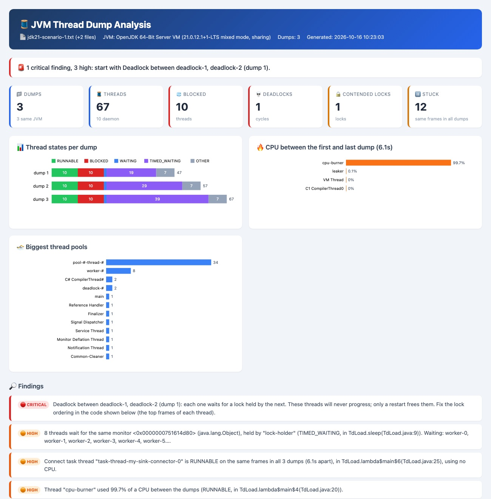

#### **📈 gc-logs**

```bash
playground analyze gc-logs --sample jdk21_g1_kafka_real
```

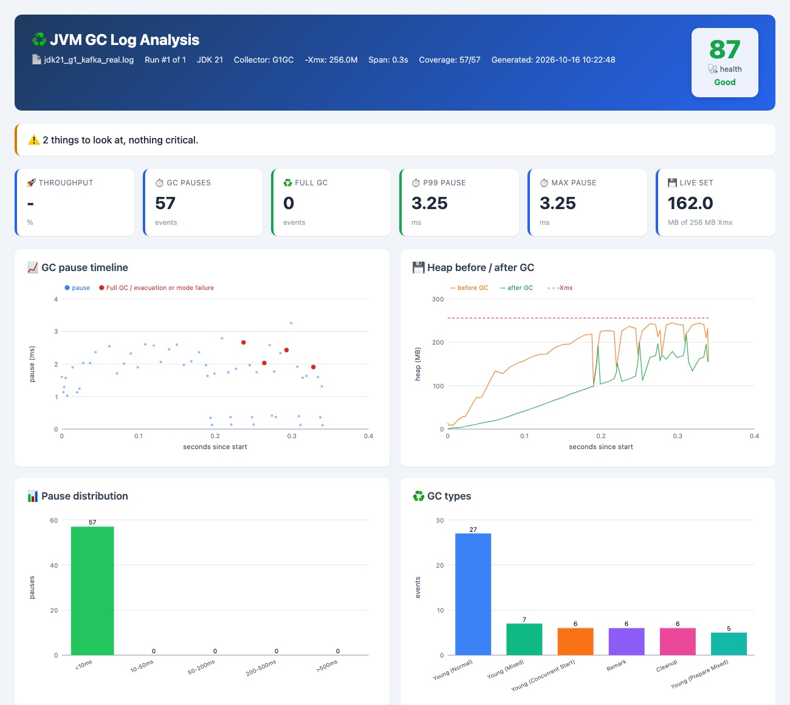

#### **🔬 heap-dump**

```bash
playground analyze heap-dump --sample leak_growth
```

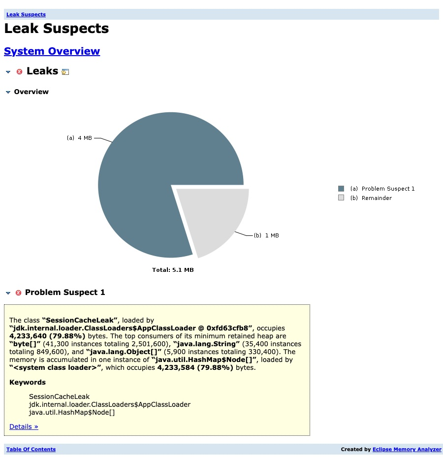

#### **🅾️ oracle-xstream-report**

```bash
playground analyze oracle-xstream-report --sample synthetic_failures
```

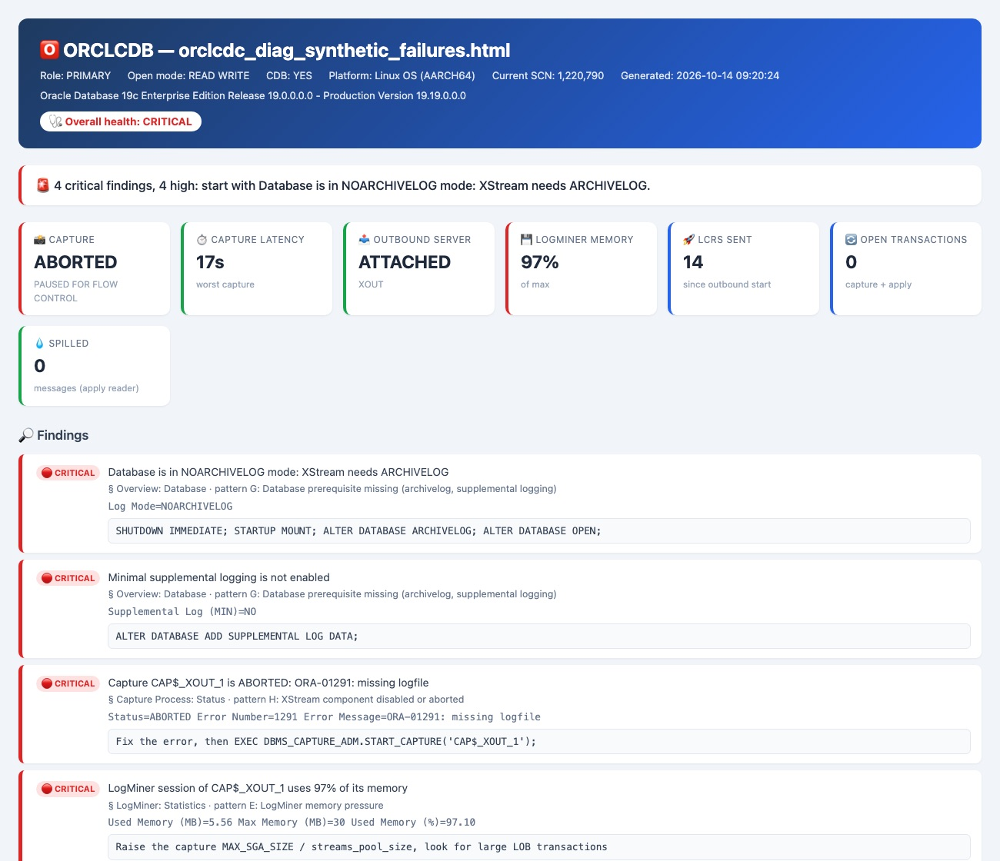

#### **📦 cfk-bundle**

```bash
playground analyze cfk-bundle --sample synthetic
```

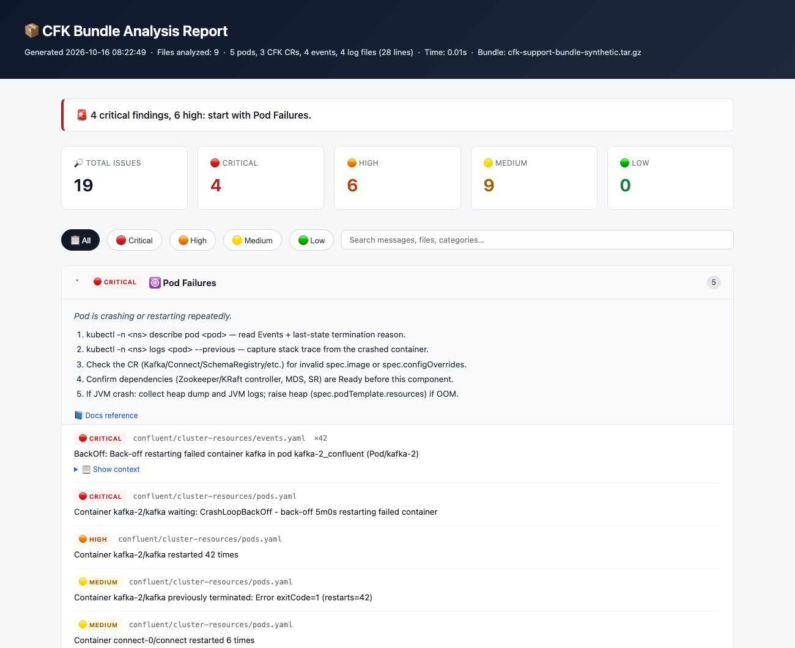

#### **🛩️ flight-recorder**

```bash
playground analyze flight-recorder --sample jdbc_postgres_sink
```

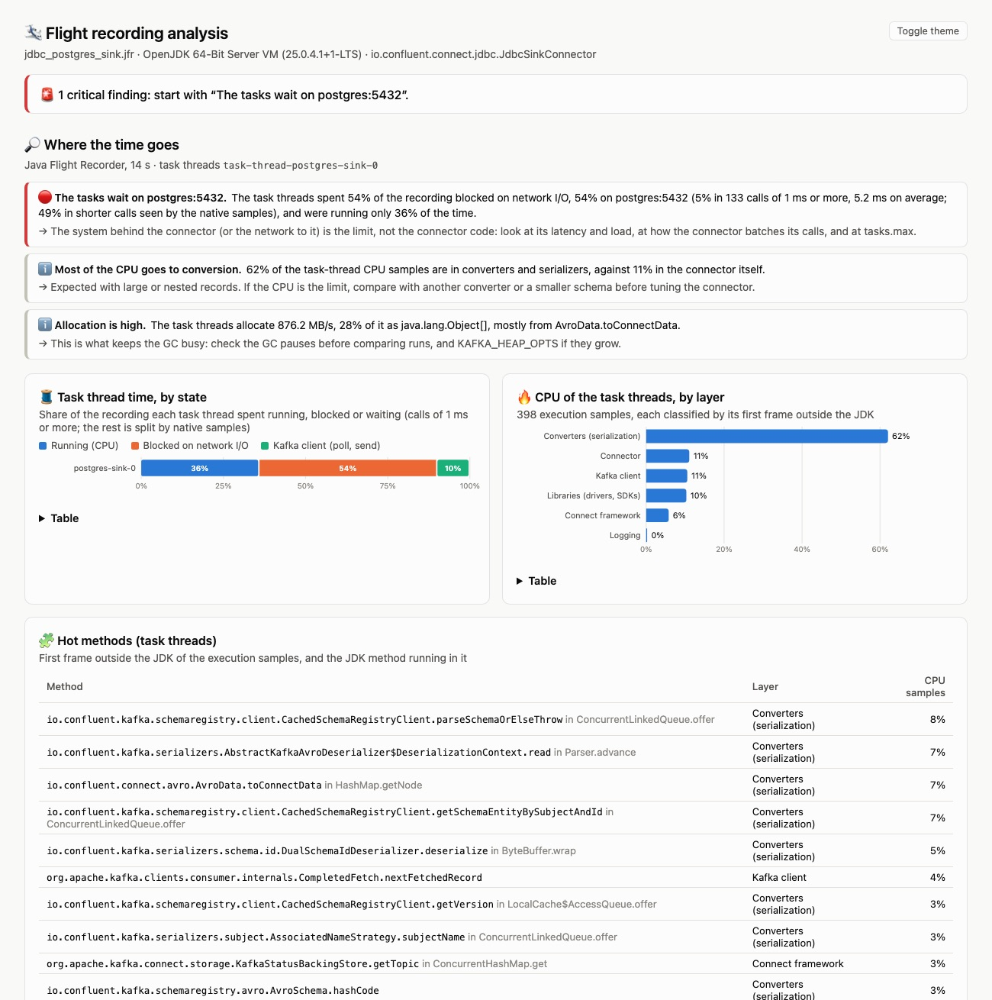

<!-- tabs:end -->

#### 🛩️ What `analyze flight-recorder` reports

It reads `.jfr` files of JDK 11+ JVMs with the flight recorder API of the JDK, run in an `eclipse-temurin:25-jdk`
container (pulled the first time), and looks at the Kafka Connect task threads (`task-thread-*`, `--connector` for one
connector, `--threads` for any regex; every thread when none matches):

| Section | Content |
|---|---|
| Findings | one sentence, a number and a next step: the tasks wait on a remote system, on the Kafka consumer fetch or the producer, on a lock, sleep; they are CPU bound; conversion, logging or SMTs take the CPU; the JVM was still compiling code (JIT); allocation, exceptions, long GC pauses |
| Task thread time, by state | share of the recording each task thread spent running, blocked on network I/O, in the Kafka client, on locks, waiting, on file I/O |
| CPU of the task threads, by layer | execution samples classified by their first frame outside the JDK: connector, converters (serialization), SMTs, Kafka client, connect framework, libraries (drivers, SDKs), logging, JDK |
| Hot methods | the methods the task threads run, with a link to the source of the connector when its manifest has one |
| Network I/O, allocation, locks and waits, busiest threads | by remote host, class, site and thread |

Recordings made with the `playground` settings (benchmark, `debug flight-recorder`, `analyze flight-recorder
--container`) give the most details; a recording made with the JDK settings works too, with throttled socket events and
10 or 20 ms thresholds.

## 🚫 Blocking traffic

To reproduce what happens when a component cannot reach another one (a broker, Schema Registry, a database or an external API going down, a firewall dropping packets), a reproduction model can block the traffic between containers or to an external host, then unblock it to check how the connector or client recovers.

Just use [CLI](/playground%20debug%20block-traffic) `playground debug block-traffic`. It uses `iptables` (installed in the container if needed) to drop the traffic from one or more containers to a destination (container name, host name or IP address), optionally on a single `--port`. Run it again with `--action stop` to restore the traffic.

```bash
playground debug block-traffic --destination google.com --action start
playground debug block-traffic --container schema-registry --destination broker --port 9092 --action start
playground debug block-traffic -c connect -c ksqldb-server --destination schema-registry --action stop
```

## 🐌 Add latency, packet loss or corruption

Some issues only happen on a slow or unreliable network: request timeouts, retries, rebalances, producer or consumer errors. A reproduction model can simulate them by adding latency, packet loss or packet corruption between two containers.

The playground provides functions (in [`scripts/cli/src/lib/utils_function.sh`](https://github.com/vdesabou/kafka-docker-playground/blob/master/scripts/cli/src/lib/utils_function.sh)) based on [`tc`](https://man7.org/linux/man-pages/man8/tc.8.html):

| Function | Usage |
|---|---|
| `add_latency` | `add_latency <src_container> <dst_container or ip> <latency>`, e.g. `add_latency connect broker 100ms` |
| `add_packet_loss` | `add_packet_loss <src_container> <dst_container or ip> <loss>`, e.g. `add_packet_loss connect broker 1%` |
| `add_packet_corruption` | `add_packet_corruption <src_container> <dst_container or ip> <corruption>`, e.g. `add_packet_corruption connect broker 1%` |
| `get_latency` | `get_latency <src_container> <dst_container>`: average ping time in ms |
| `clear_traffic_control` | `clear_traffic_control <src_container>`: removes all `tc` settings |

> [!TIP]
> A complete example is available [here](https://github.com/vdesabou/kafka-docker-playground/blob/master/other/monitoring-sink-latency/start.sh).

*Example:*

```bash
latency=$(get_latency connect broker)
log "Latency from connect to broker BEFORE traffic control: $latency ms"

add_latency connect broker 100ms

latency=$(get_latency connect broker)
log "Latency from connect to broker AFTER traffic control: $latency ms"

log "Clear traffic control"
clear_traffic_control connect
```

> [!NOTE]
> The source container needs the `tc` tool (`iproute-tc` package). The `connect` image used by the playground has it installed.

## 🧰 Useful functions for reproduction models

All examples source [`scripts/utils.sh`](https://github.com/vdesabou/kafka-docker-playground/blob/master/scripts/utils.sh), which loads the functions from [`scripts/cli/src/lib/utils_function.sh`](https://github.com/vdesabou/kafka-docker-playground/blob/master/scripts/cli/src/lib/utils_function.sh). The most useful ones:

| Function | Usage |
|---|---|
| `wait_for_log` | `wait_for_log "<message>" [container, default connect] [max wait in seconds, default 600]`: wait until a message appears in container logs. Prefer this over `sleep`. CLI equivalent: `playground container logs -c connect --wait-for-log "<message>" --max-wait 120` |
| `playground connector create-or-update --wait` | not a function but a flag: wait until the connector and all its tasks are RUNNING after creating it, and fail with the stack trace otherwise. Prefer this over `sleep` after creating a connector. Also `playground connector wait --connector <c>` and `playground topic wait-for-records --topic <t> --min-expected-messages N` |
| `wait_for_datagen_connector_to_inject_data` | `wait_for_datagen_connector_to_inject_data <connector name> <nb tasks>`: wait until a datagen connector has produced its configured number of messages |
| `retrycmd` | `retrycmd <max attempts> <sleep interval in seconds> <command>`: run a command until it succeeds, e.g. `retrycmd 10 5 check_my_condition` |
| `block_host` / `remove_partition` | `block_host <container> <ip>...` drops all traffic from a container to the given IPs, `remove_partition <container>...` removes it |
| `version_gt` | `if version_gt $TAG_BASE "7.9.99"; then ... fi`: compare versions |
| `connect_cp_version_greater_than_8` | `if connect_cp_version_greater_than_8; then ... fi`: true when the Connect image is CP 8.x or later |
| `get_3rdparty_file` | `get_3rdparty_file <file>`: download a third-party file (driver, jar...) if it is not already present |
| `install_connector_with_retry` | `install_connector_with_retry "<install command>"`: install a connector, with retries (`CONNECTOR_INSTALL_MAX_RETRIES`, default 5) |
| `create_topic` / `delete_topic` | `create_topic <topic>`: create or delete a topic on Confluent Cloud (uses the `confluent` CLI, for `ccloud` examples) |

## 🏚 Simulate TCP connections problems

[emicklei/zazkia](https://github.com/emicklei/zazkia) is a nice tool to simulate a TCP connection issues (reset,delay,throttle,corrupt).

Just use [CLI](/playground%20tcp-proxy) `playground tcp-proxy`.

Main commands (see [CLI](/playground%20tcp-proxy) for the full list):

| Command | Description |
|---|---|
| [`start`](/playground%20tcp-proxy%20start) | 💗 Start the TCP proxy and automatically replace connector config with zazkia hostname and port 49998 |
| [`open-ui`](/playground%20tcp-proxy%20open-ui) | 🌐 Open the Zazkia UI |
| [`get-connections`](/playground%20tcp-proxy%20get-connections) | 🧲 Get Zazkia active TCP connections config and stats |
| [`delay`](/playground%20tcp-proxy%20delay) | ⏲️ Add milliseconds delay to service response |
| [`break`](/playground%20tcp-proxy%20break) | 💔 Break sending the response to the client |
| [`close-connection`](/playground%20tcp-proxy%20close-connection) | ❌ Close the Zazkia active TCP connections |
| [`close-all-connection-with-error`](/playground%20tcp-proxy%20close-all-connection-with-error) | 🧹 Close all Zazkia TCP connections which are in error state |
| [`toggle-accept-connections`](/playground%20tcp-proxy%20toggle-accept-connections) | 🙅‍♂️ Change whether new connections can be accepted |
| [`toggle-reads-client`](/playground%20tcp-proxy%20toggle-reads-client) / [`toggle-reads-service`](/playground%20tcp-proxy%20toggle-reads-service) | ✅ Change whether reading data from the client / service is enabled |
| [`toggle-writes-client`](/playground%20tcp-proxy%20toggle-writes-client) / [`toggle-writes-service`](/playground%20tcp-proxy%20toggle-writes-service) | ✅ Change whether writing data to the client / service is enabled |

## 🌐 Using HTTPS proxy

There are several connector examples which include HTTPS proxy (check for `also with 🌐 proxy` in the **[Content](/content.md)** section).

> [!TIP]
> A complete example is available [here](https://github.com/vdesabou/kafka-docker-playground/blob/master/connect/connect-aws-s3-sink/s3-sink-proxy.sh). 

Here are the steps to follow:

1. Copy [`connect/connect-aws-s3-sink/nginx-proxy`](https://github.com/vdesabou/kafka-docker-playground/tree/master/connect/connect-aws-s3-sink/nginx-proxy) directory into your test directory.

2. Update [`connect/connect-aws-s3-sink/nginx-proxy/nginx_whitelist.conf`](https://github.com/vdesabou/kafka-docker-playground/blob/master/connect/connect-aws-s3-sink/nginx-proxy/nginx_whitelist.conf) with the domain name required for your needs.

*Example:*

```conf
        server_name  service-now.com;
        server_name  *.service-now.com;
```

> [!TIP]
> If you need a proxy to reach another docker container, as opposed to a domain, use following example, where `schema-registry` is the name of the container:

```nginx
http {
    access_log /var/log/nginx_access.log;
    error_log /var/log/nginx_errors.log;

    upstream docker-schema-registry {
        server schema-registry:8081;
    }

    server {
        listen       8888;
        location / {
            proxy_pass         http://docker-schema-registry;
            proxy_redirect     off;
            proxy_set_header   Host $host;
            proxy_set_header   X-Real-IP $remote_addr;
            proxy_set_header   X-Forwarded-For $proxy_add_x_forwarded_for;
            proxy_set_header   X-Forwarded-Host $server_name;
        }
    }
}
```

3. Add this in your `docker-compose` file:

```yml
  nginx-proxy:
    image: reiz/nginx_proxy:latest
    hostname: nginx-proxy
    container_name: nginx-proxy
    ports:
      - "8888:8888"
    volumes:
      - ../../connect/connect-aws-s3-sink/nginx-proxy/nginx_whitelist.conf:/usr/local/nginx/conf/nginx.conf
```

> [!WARNING]
> Make sure to update `../../connect/connect-aws-s3-sink` above with the right path.

4. [Optional] In order to make sure the proxy is used, you can set `dns: 0.0.0.0` in the connect instance, so that there is no internet connectivity.

```yml
  connect:
    <snip>
    environment:
      <snip>
    dns: 0.0.0.0
```

5. In your connector configuration, update the proxy configuration parameter with `http://nginx-proxy:8888`.

*Example:*

```json
"s3.proxy.url": "http://nginx-proxy:8888"
```

> [!NOTE]
> If your proxy requires HTTP2 support, there is a full example available in this example: [GCP Pub/Sub Source connector](https://github.com/vdesabou/kafka-docker-playground/blob/master/connect/connect-gcp-pubsub-source/gcp-pubsub-source-nginx-proxy.sh)

### 🔐 Proxy with BASIC authentication

If you want to setup BASIC authentication, you can use [ubuntu/squid](https://hub.docker.com/r/ubuntu/squid) image.

> [!TIP]
> Some complete examples are available [here](https://github.com/vdesabou/kafka-docker-playground/blob/master/connect/connect-aws-s3-sink/s3-sink-proxy-basic-auth.sh) and [there](https://github.com/vdesabou/kafka-docker-playground/blob/master/connect/connect-salesforce-platform-events-sink/salesforce-platform-events-sink-proxy-basic-auth.sh)

* in your `docker-compose`, add `squid` as below:


```yml
  squid:
    image: ubuntu/squid
    hostname: squid
    container_name: squid
    ports:
      - "8888:8888"
    volumes:
      - ../../connect/connect-aws-s3-sink/squid/passwords:/etc/squid/passwords
      - ../../connect/connect-aws-s3-sink/squid/squid.conf:/etc/squid/squid.conf
```

Proxy details:

* container: squid
* port: 8888
* user: admin
* password: 1234

Example with S3 sink:

```json
  "s3.proxy.url": "http://squid:8888",
  "s3.proxy.user": "admin",
  "s3.proxy.password": "1234",
```

Example with Salesforce:

```json
  "http.proxy": "squid:8888",
  "http.proxy.auth.scheme": "BASIC",
  "http.proxy.user": "admin",
  "http.proxy.password": "1234",
```

## ♨️ Using specific JDK

Some issues depend on the Java version or vendor (TLS protocols and cipher suites, a JVM bug, a library that needs a more recent Java, a difference seen only with the customer's JDK). To reproduce them, you can replace the JDK installed in a container image (connect, broker, control-center…) with another version or vendor.

Here are some examples:

### 🌀 Azul Zulu JDK

Just use [playground container change-jdk](/playground%20container%20change-jdk) CLI command !

Example:

```bash
$ playground container change-jdk --version 21 --container control-center 
17:03:25 ℹ️ 🤎 Installing Azul JDK 21 on container control-center /usr/lib/jvm/java-11-zulu-openjdk/bin/java
17:03:25 ℹ️ Executing command as root in container control-center with bash
Last metadata expiration check: 0:26:16 ago on Fri May 24 14:37:10 2024.
zulu-repo-1.0.0-1.noarch.rpm                    4.4 kB/s | 3.0 kB     00:00    
Package zulu-repo-1.0.0-1.noarch is already installed.
Dependencies resolved.
Nothing to do.
Complete!
Last metadata expiration check: 0:26:17 ago on Fri May 24 14:37:10 2024.
Dependencies resolved.
================================================================================
 Package                     Architecture Version       Repository         Size
================================================================================
Installing:
 zulu21-jdk                  aarch64      21.0.3-1      zulu-openjdk      4.3 k
Installing dependencies:
 zulu21-ca-doc               aarch64      21.0.3-1      zulu-openjdk      232 k
 zulu21-ca-jdk               aarch64      21.0.3-1      zulu-openjdk       23 k
 zulu21-ca-jdk-headless      aarch64      21.0.3-1      zulu-openjdk       81 M
 zulu21-ca-jre               aarch64      21.0.3-1      zulu-openjdk      354 k
 zulu21-ca-jre-headless      aarch64      21.0.3-1      zulu-openjdk       47 M
 zulu21-doc                  aarch64      21.0.3-1      zulu-openjdk      4.2 k
 zulu21-jdk-headless         aarch64      21.0.3-1      zulu-openjdk      4.3 k
 zulu21-jre                  aarch64      21.0.3-1      zulu-openjdk      4.2 k
 zulu21-jre-headless         aarch64      21.0.3-1      zulu-openjdk      4.2 k

Transaction Summary
================================================================================
Install  10 Packages

Total download size: 128 M
Installed size: 295 M
Downloading Packages:
(1/10): zulu21-ca-jdk-21.0.3-1.aarch64.rpm      180 kB/s |  23 kB     00:00    
(2/10): zulu21-ca-doc-21.0.3-1.aarch64.rpm      1.2 MB/s | 232 kB     00:00    
(3/10): zulu21-ca-jre-21.0.3-1.aarch64.rpm      1.5 MB/s | 354 kB     00:00    
(4/10): zulu21-doc-21.0.3-1.aarch64.rpm          36 kB/s | 4.2 kB     00:00    
(5/10): zulu21-jdk-21.0.3-1.aarch64.rpm          66 kB/s | 4.3 kB     00:00    
(6/10): zulu21-jdk-headless-21.0.3-1.aarch64.rp  36 kB/s | 4.3 kB     00:00    
(7/10): zulu21-jre-21.0.3-1.aarch64.rpm          76 kB/s | 4.2 kB     00:00    
(8/10): zulu21-jre-headless-21.0.3-1.aarch64.rp 100 kB/s | 4.2 kB     00:00    
(9/10): zulu21-ca-jre-headless-21.0.3-1.aarch64 3.2 MB/s |  47 MB     00:14    
(10/10): zulu21-ca-jdk-headless-21.0.3-1.aarch6 5.3 MB/s |  81 MB     00:15    
--------------------------------------------------------------------------------
Total                                           8.4 MB/s | 128 MB     00:15     
Running transaction check
Transaction check succeeded.
Running transaction test
Transaction test succeeded.
Running transaction
  Running scriptlet: zulu21-ca-jre-headless-21.0.3-1.aarch64                1/1 
  Running scriptlet: zulu21-ca-jdk-headless-21.0.3-1.aarch64                1/1 
  Running scriptlet: zulu21-ca-jre-21.0.3-1.aarch64                         1/1 
  Running scriptlet: zulu21-jre-headless-21.0.3-1.aarch64                   1/1 
  Running scriptlet: zulu21-ca-doc-21.0.3-1.aarch64                         1/1 
  Running scriptlet: zulu21-ca-jdk-21.0.3-1.aarch64                         1/1 
  Running scriptlet: zulu21-doc-21.0.3-1.aarch64                            1/1 
  Running scriptlet: zulu21-jdk-headless-21.0.3-1.aarch64                   1/1 
  Running scriptlet: zulu21-jre-21.0.3-1.aarch64                            1/1 
  Running scriptlet: zulu21-jdk-21.0.3-1.aarch64                            1/1 
  Preparing        :                                                        1/1 
  Installing       : zulu21-ca-jre-headless-21.0.3-1.aarch64               1/10 
  Running scriptlet: zulu21-ca-jre-headless-21.0.3-1.aarch64               1/10 
  Installing       : zulu21-ca-jdk-headless-21.0.3-1.aarch64               2/10 
  Running scriptlet: zulu21-ca-jdk-headless-21.0.3-1.aarch64               2/10 
  Installing       : zulu21-ca-jre-21.0.3-1.aarch64                        3/10 
  Running scriptlet: zulu21-ca-jre-21.0.3-1.aarch64                        3/10 
  Installing       : zulu21-jre-headless-21.0.3-1.aarch64                  4/10 
  Running scriptlet: zulu21-jre-headless-21.0.3-1.aarch64                  4/10 
  Installing       : zulu21-ca-doc-21.0.3-1.aarch64                        5/10 
  Running scriptlet: zulu21-ca-doc-21.0.3-1.aarch64                        5/10 
  Installing       : zulu21-ca-jdk-21.0.3-1.aarch64                        6/10 
  Running scriptlet: zulu21-ca-jdk-21.0.3-1.aarch64                        6/10 
  Installing       : zulu21-doc-21.0.3-1.aarch64                           7/10 
  Running scriptlet: zulu21-doc-21.0.3-1.aarch64                           7/10 
  Installing       : zulu21-jdk-headless-21.0.3-1.aarch64                  8/10 
  Running scriptlet: zulu21-jdk-headless-21.0.3-1.aarch64                  8/10 
  Installing       : zulu21-jre-21.0.3-1.aarch64                           9/10 
  Running scriptlet: zulu21-jre-21.0.3-1.aarch64                           9/10 
  Installing       : zulu21-jdk-21.0.3-1.aarch64                          10/10 
  Running scriptlet: zulu21-jdk-21.0.3-1.aarch64                          10/10 
  Running scriptlet: zulu21-ca-jre-headless-21.0.3-1.aarch64              10/10 
  Running scriptlet: zulu21-ca-jdk-headless-21.0.3-1.aarch64              10/10 
  Running scriptlet: zulu21-ca-jre-21.0.3-1.aarch64                       10/10 
  Running scriptlet: zulu21-jre-headless-21.0.3-1.aarch64                 10/10 
  Running scriptlet: zulu21-ca-doc-21.0.3-1.aarch64                       10/10 
  Running scriptlet: zulu21-ca-jdk-21.0.3-1.aarch64                       10/10 
  Running scriptlet: zulu21-doc-21.0.3-1.aarch64                          10/10 
  Running scriptlet: zulu21-jdk-headless-21.0.3-1.aarch64                 10/10 
  Running scriptlet: zulu21-jre-21.0.3-1.aarch64                          10/10 
  Running scriptlet: zulu21-jdk-21.0.3-1.aarch64                          10/10 
  Verifying        : zulu21-ca-doc-21.0.3-1.aarch64                        1/10 
  Verifying        : zulu21-ca-jdk-21.0.3-1.aarch64                        2/10 
  Verifying        : zulu21-ca-jdk-headless-21.0.3-1.aarch64               3/10 
  Verifying        : zulu21-ca-jre-21.0.3-1.aarch64                        4/10 
  Verifying        : zulu21-ca-jre-headless-21.0.3-1.aarch64               5/10 
  Verifying        : zulu21-doc-21.0.3-1.aarch64                           6/10 
  Verifying        : zulu21-jdk-21.0.3-1.aarch64                           7/10 
  Verifying        : zulu21-jdk-headless-21.0.3-1.aarch64                  8/10 
  Verifying        : zulu21-jre-21.0.3-1.aarch64                           9/10 
  Verifying        : zulu21-jre-headless-21.0.3-1.aarch64                 10/10 

Installed:
  zulu21-ca-doc-21.0.3-1.aarch64           zulu21-ca-jdk-21.0.3-1.aarch64       
  zulu21-ca-jdk-headless-21.0.3-1.aarch64  zulu21-ca-jre-21.0.3-1.aarch64       
  zulu21-ca-jre-headless-21.0.3-1.aarch64  zulu21-doc-21.0.3-1.aarch64          
  zulu21-jdk-21.0.3-1.aarch64              zulu21-jdk-headless-21.0.3-1.aarch64 
  zulu21-jre-21.0.3-1.aarch64              zulu21-jre-headless-21.0.3-1.aarch64 

Complete!
17:03:54 ℹ️ Executing command as root in container control-center with bash
17:03:54 ℹ️ Restarting docker container control-center
control-center
17:04:02 ℹ️ Executing command in container control-center with bash
openjdk version "21.0.3" 2024-04-16 LTS
OpenJDK Runtime Environment Zulu21.34+19-CA (build 21.0.3+9-LTS)
OpenJDK 64-Bit Server VM Zulu21.34+19-CA (build 21.0.3+9-LTS, mixed mode, sharing)
```

### ⭕️ Oracle JDK

Here are the steps to follow:

1. Get the Oracle JDK `.rpm` version link you want to install from the [website](https://www.oracle.com/java/technologies/downloads/). In our example, that will be `jdk-21_linux-x64_bin.rpm`

> [!NOTE]
> CP 8.x requires Java 17 or later, so pick a JDK 17+ build. CP images are based on UBI minimal, which ships `microdnf` and not `yum`: the `Dockerfile` below installs `yum` first.

2. Add this in your `docker-compose` file:

```yml
  connect:
    build:
      context: ../../connect/connect-filestream-sink/
      args:
        CP_CONNECT_IMAGE: ${CP_CONNECT_IMAGE}
        CP_CONNECT_TAG: ${CP_CONNECT_TAG}
```
> [!WARNING]
> Make sure to update `context` above with the right path.

3. Create a `Dockerfile` file in `context` directory above (`../../connect/connect-filestream-sink/`).

```dockerfile
ARG CP_CONNECT_IMAGE
ARG CP_CONNECT_TAG
FROM ${CP_CONNECT_IMAGE}:${CP_CONNECT_TAG}
COPY jdk-21_linux-x64_bin.rpm /tmp/
USER root
RUN if command -v microdnf >/dev/null 2>&1; then microdnf -y install yum; fi \
 && yum -y install /tmp/jdk-21_linux-x64_bin.rpm \
 && alternatives --set java /usr/lib/jvm/jdk-21-oracle-x64/bin/java \
 && rm /tmp/jdk-21_linux-x64_bin.rpm
USER appuser
```

> [!WARNING]
> Make sure to update `alternatives --set java` above with the right path.

4. Verify the correct JDK version is installed once your test is started:

```bash
playground container exec -c connect --command "java -version"
```

## 🏎️ Performance testing

[playground connector benchmark](https://kafka-docker-playground.io/#/playground%20connector%20benchmark) is the way to do performance testing with the playground. On a running self managed example or reproduction model, it loads the data, measures the throughput of the connector, tells whether the connector is really the bottleneck, records where its time goes, compares with the previous run or with other versions of the connector, and writes an HTML report to share.

| I want to | Use |
|---|---|
| measure a connector | `playground connector benchmark`: the load comes with the example (the `playground topic produce` of a sink example is replayed, a source example has a `benchmark-load.bash`) |
| compare connector versions | `playground connector benchmark --connector-tag A --connector-tag B` |
| use my own data | [your own load](/reusables?id=your-own-load) (`--load-command`, or a load script, like the Salesforce source example below) |
| load a table of my own in a reproduction model | [a table of your own](/reusables?id=a-table-of-your-own-reproduction-models) (`BENCHMARK_LOAD_SCRIPT`) |
| see the broker, the JVM, the connector dashboards | start the example with [JMX Grafana](https://kafka-docker-playground.io/#/how-to-use?id=%f0%9f%93%8a-enabling-jmx-grafana) (`--enable-jmx-grafana`): the benchmark [annotates its measure](/reusables?id=%f0%9f%93%8a-grafana) |
| keep a database busy while I watch | [`--enable-sql-datagen`](/reusables?id=%f0%9f%8c%aa%ef%b8%8f-databases-keep-a-load-running-with-enable-sql-datagen) |

### ⏱️ Benchmark a connector

[playground connector benchmark](https://kafka-docker-playground.io/#/playground%20connector%20benchmark) measures the throughput of a running self managed connector, so that you can compare two runs: another `--connector-tag`, another config, another number of tasks, or the numbers of a customer.

By default (`--mode drain`), it pauses the connector, loads a backlog of `--nb-records`, resumes the connector and measures the time it takes to process it. This is the most reproducible number, since it does not depend on how fast the load is generated. `--mode steady` measures the throughput during `--duration` while a load runs in the background.

```bash
# sink: the 'playground topic produce' of the example script is replayed with 3M records
playground connector benchmark --nb-records 3000000

# source: rows inserted in the source database by the benchmark-load.bash of the example
playground connector benchmark --nb-records 1000000 --shape bulk
playground connector benchmark --nb-records 100000 --shape small-txn
playground connector benchmark --nb-records 1000000 --shape update

# throughput during 5 minutes, with a load running in the background
playground connector benchmark --mode steady --duration 5m

# source: the load in 5 parallel sessions (concurrent transactions)
playground connector benchmark --nb-records 1000000 --shape small-txn --sessions 5
```

`--sessions <n>` runs the `benchmark-load.bash` of the example in `n` parallel sessions: a drain splits `--nb-records` between them, steady mode gives each session batches of `--nb-records`. Concurrent transactions are what a busy database looks like to a CDC connector (interleaved transactions in the redo log or the WAL, several open transactions).

The load comes from the example:

* **sink connectors**: the `playground topic produce` of the example script that feeds the connector is replayed with `--nb-messages <n>` (same schema, key and headers), so it works with almost every sink example
* **source connectors**: `benchmark-load.bash` next to the example script, called with `--check` first so that an unsupported combination fails before the connector is paused:
  * JDBC and Debezium PostgreSQL, Debezium MySQL, JDBC and Debezium SQL Server, Oracle CDC, Oracle XStream, Debezium Oracle and JDBC Oracle: rows in the `CUSTOMERS` table (`dbo.customers` for SQL Server), in one transaction (`--shape bulk`), one transaction per row (`--shape small-txn`) or as updates (`--shape update`, refused for a JDBC source in `incrementing` mode, which does not capture updates)
  * MongoDB: documents in the collection of the connector, with the shape of an existing document so that the schema inferred by the connector stays compatible (`bulk`: insertMany, `small-txn`: insertOne, `update`)
  * IBM MQ: messages put in the queue of the connector with `amqsput` (the max depth of the queue is raised first)
  * MQTT: messages published with `mosquitto_pub`, **steady mode only**: a paused MQTT source stays subscribed, so the messages published while it is paused go to its in-memory buffer or are dropped by the broker
  * IBM MQ (Confluent and ibm-messaging connectors): messages put in the queue with `amqsput`
  * ActiveMQ, WebLogic, TIBCO EMS (and their JMS source variants): messages sent with `BenchmarkJmsProducer` (`tools/benchmark-jms`), a small JMS producer run with the client jars of the broker and the JNDI settings of the connector (`--shape bulk`: transactions of 1000 messages, `--shape small-txn`: one send per message). A topic destination is measured with `--mode steady` only
  * RabbitMQ: messages published with the `producer.py` of the example
  * Solace (and JMS Solace): messages sent through the REST messaging port of the broker
  * Splunk: events sent to the HTTP event collector of the connector, **steady mode only** (the connector keeps the events received while it is paused in memory)
  * Salesforce Bulk API source: Leads created in Salesforce with one Bulk API job (`--shape bulk` drain only, see [the example below](/reusables?id=a-real-life-example-the-salesforce-bulk-api-source))
* or your own command with `--load-command` (drain) / `--stream-load-command` (steady), for example in a reproduction model (see below)

#### Your own load

Both commands run with `bash -c`, from the current directory. The examples below use a predefined schema of the CLI (`--value @predefined-schemas/avro/customer.avsc`): use the schema of the records your connector expects.

**Drain** (`--load-command`): the command runs while the connector is paused, creates the records and returns. `--nb-records` is the number of records the connector should then process, unless the command prints a line `BENCHMARK_RECORDS=<n>`:

```bash
# sink: 1M records in the topic of the connector
playground connector benchmark --nb-records 1000000 \
  --load-command "playground topic produce -t my-topic --nb-messages 1000000 --value @predefined-schemas/avro/customer.avsc"

# source: your own script, which inserts the rows and prints BENCHMARK_RECORDS=<n>
playground connector benchmark --load-command "./load-my-table.sh 500000"
```

**Steady** (`--stream-load-command`): the command runs in the background. At the end of the measure, the file named by the `BENCHMARK_STOP_FILE` environment variable is created: stop at the end of the current batch when it exists. The command is killed after 120s otherwise, and killing a producer in the middle of a batch can send a truncated record to the topic. Print `BENCHMARK_BATCH=<records> <epoch seconds>` after each batch, so that the summary can tell when the connector only kept up with the load:

```bash
playground connector benchmark --mode steady --duration 2m \
  --stream-load-command 'while [ ! -f "$BENCHMARK_STOP_FILE" ]; do playground topic produce -t my-topic --nb-messages 10000 --value @predefined-schemas/avro/customer.avsc; echo "BENCHMARK_BATCH=10000 $(date +%s)"; done'
```

##### A real-life example: the Salesforce Bulk API source

The [Salesforce Bulk API source example](https://github.com/vdesabou/kafka-docker-playground/tree/master/connect/connect-salesforce-bulkapi-source) reads Leads from a Salesforce org. To benchmark it, the load must create Leads **in Salesforce**, so that the connector picks them up like in production. Creating them one by one (`sfdx data:create:record`) would take one API call per Lead: [its `benchmark-load.bash`](https://github.com/vdesabou/kafka-docker-playground/blob/master/connect/connect-salesforce-bulkapi-source/benchmark-load.bash) creates them with **one Bulk API job**:

```bash
# the Salesforce user of the connector: the connect REST API shows it (only passwords are masked),
# and the sfdx-cli container of the example is already logged in with it
username=$(benchmark_connector_config_value salesforce.username)

# <records> Leads in one Bulk API job: an upsert on Id with an empty Id inserts every row
awk -v n="$records" -v run="$(date +%s)" 'BEGIN {
  print "Id,FirstName,LastName,Company"
  for (i = 1; i <= n; i++) printf ",Lead%d,benchmark-%s-%d,playground-benchmark\n", i, run, i
}' | playground container exec --container sfdx-cli --command "cat > /tmp/benchmark-leads.csv"
playground container exec --container sfdx-cli --command "sfdx force:data:bulk:upsert --target-org '$username' -s Lead -f /tmp/benchmark-leads.csv -i Id -w 30 --json"

# one record per Lead in the topic of the connector
echo "BENCHMARK_RECORDS=$records"
```

It also deletes the Leads of the previous runs first (a developer org holds about 2500 Leads, 5 MB of data storage), and refuses anything else than a drain with `--shape bulk` in its `--check`. Then:

```bash
playground run -f connect/connect-salesforce-bulkapi-source/salesforce-bulkapi-source.sh
playground connector benchmark --connector salesforce-bulkapi-source --nb-records 1000
```

On a developer org, the 1000 Leads were created in 25 s (one Bulk API job), and the connector wrote them to `sfdc-bulkapi-leads` in 13 s, about 76 records/s. They arrived in bursts, each time a Bulk API query job of the connector completed: with a few thousand Leads, this mostly measures the latency of the query jobs of the org, which is exactly what a customer sees too.

The same pattern works for any source system: create the data **at the source** with its own bulk tools, wait for nothing (the connector is paused), print `BENCHMARK_RECORDS=<n>`.

#### A table of your own (reproduction models)

The loads shipped with the examples always write the `CUSTOMERS` table of the example (`dbo.customers` for SQL Server). When a reproduction model reads another table, the one of the customer for example, give it a load script of its own, **named after its ticket**, next to the reproduction model script, and select it with `BENCHMARK_LOAD_SCRIPT`:

```bash
BENCHMARK_LOAD_SCRIPT=benchmark-load-123456.bash playground connector benchmark --nb-records 500000
```

`BENCHMARK_LOAD_SCRIPT` is a file name in the folder of the script that was run (or an absolute path): several reproduction models of the same folder can each have their load. Without it, the benchmark uses the `benchmark-load.bash` of the folder. `--enable-sql-datagen` uses it too, and the summary and the report work as with the examples: `--check` before the connector is paused, the drain, steady mode, the warnings, plus a warning when the previous run used another load script.

The public example [`connect/connect-jdbc-postgresql-source/postgres-orders.sh`](https://github.com/vdesabou/kafka-docker-playground/blob/master/connect/connect-jdbc-postgresql-source/postgres-orders.sh) does exactly that: it creates an `orders` table with a JDBC source connector on it, next to `postgres.sh` and the `CUSTOMERS` load of the folder, and its load is [`benchmark-load-orders.bash`](https://github.com/vdesabou/kafka-docker-playground/blob/master/connect/connect-jdbc-postgresql-source/benchmark-load-orders.bash):

```bash
playground run -f connect/connect-jdbc-postgresql-source/postgres-orders.sh
BENCHMARK_LOAD_SCRIPT=benchmark-load-orders.bash playground connector benchmark --nb-records 1000000
BENCHMARK_LOAD_SCRIPT=benchmark-load-orders.bash playground connector benchmark --nb-records 100000 --shape small-txn --sessions 4
BENCHMARK_LOAD_SCRIPT=benchmark-load-orders.bash playground connector benchmark --mode steady --duration 2m --nb-records 2000   # batches of 2000 rows
```

`playground repro bootstrap` links the `benchmark-load.bash` of the example into the folder of the reproduction model, so the `CUSTOMERS` load works out of the box. Don't edit it: it is a link to the file of the example. Write `benchmark-load-<ticket>.bash` instead.

> [!NOTE]
> Reproduction models created before the link existed have no load: link the one of their example (`ln -s ../../connect/<example>/benchmark-load.bash .` in their folder), or write their own.

The load script of `postgres-orders.sh`, a template for yours (copy it as `benchmark-load-<ticket>.bash` and change the table, the SQL and the client):

```bash
#!/bin/bash
# load for 'playground connector benchmark' (BENCHMARK_LOAD_SCRIPT=benchmark-load-orders.bash) and --enable-sql-datagen:
# rows in the orders table of postgres-orders.sh, a table of your own (see "A table of your own" in the documentation)
set -e
DIR="$( cd "$( dirname "${BASH_SOURCE[0]}" )" >/dev/null && pwd )"
# only the functions: sourcing scripts/utils.sh would record this script as the example being run
source ${DIR}/../../scripts/cli/src/lib/utils_function.sh

# --records <n> --mode preload|stream --shape bulk|small-txn|update [--check]
benchmark_load_args "$@"
records="$BENCHMARK_LOAD_RECORDS"

# --check: called before the connector is paused, refuse what this load cannot do
if [ -n "$BENCHMARK_LOAD_CHECK" ]
then
  if [ "$BENCHMARK_LOAD_SHAPE" == "update" ]
  then
    # the connector of postgres-orders.sh is in incrementing mode: it only captures new rows
    logerror "❌ this load only inserts rows (the connector is in incrementing mode): use --shape bulk or small-txn"
    exit 1
  fi
  exit 0
fi

case "$BENCHMARK_LOAD_SHAPE" in
  bulk)
    # one transaction with all the rows
    sql="INSERT INTO orders (customer_id, product, quantity, price) SELECT i % 1000, 'product ' || (i % 50), 1 + i % 5, round((random() * 100)::numeric, 2) FROM generate_series(1, $records) AS i;"
  ;;
  small-txn)
    # one transaction per row
    sql="DO \$\$ BEGIN FOR i IN 1..$records LOOP INSERT INTO orders (customer_id, product, quantity, price) VALUES (i % 1000, 'product ' || (i % 50), 1 + i % 5, round((random() * 100)::numeric, 2)); COMMIT; END LOOP; END \$\$;"
  ;;
esac

function load_batch () {
  echo "$sql" | playground container exec --container postgres --command "psql -U myuser -d postgres" > /dev/null
}

if [ "$BENCHMARK_LOAD_MODE" == "stream" ]
then
  # steady mode: batches of <records> rows until the benchmark creates $BENCHMARK_STOP_FILE
  benchmark_stream_batches "$records" load_batch
else
  # drain: load the backlog, and tell the benchmark how many records the connector should write
  load_batch
  echo "BENCHMARK_RECORDS=$records"
fi
```

What the benchmark expects from the script:

| | |
|---|---|
| arguments | `--records <n> --mode preload\|stream --shape bulk\|small-txn\|update`, parsed by `benchmark_load_args`, and `--check` first, before the connector is paused: exit with an error for a combination the load cannot do |
| drain (`preload`) | load the rows and return, printing `BENCHMARK_RECORDS=<n>`: the number of records the connector should write (2 per row for Oracle CDC with a redo log topic, for example) |
| steady (`stream`) | repeat batches until the file `$BENCHMARK_STOP_FILE` exists, printing `BENCHMARK_BATCH=<records> <epoch>` after each batch: `benchmark_stream_batches <records> <command>` does both, and never stops a batch in the middle |
| environment | `BENCHMARK_TEST_FILE` (the script that was run: when several reproduction models share the folder, branch on it), `BENCHMARK_CONNECTOR`, `BENCHMARK_CONNECTOR_CONFIG` (a json file with the connector config) |
| source | `scripts/cli/src/lib/utils_function.sh`, not `scripts/utils.sh`, which would record the load script as the example being run |

The same works with MySQL (`mysql -u ... -p...`), Oracle (`sqlplus`, see `benchmark_oracle_client_from_example`) or SQL Server (`sqlcmd`): only the SQL and the client change. For a one-off measure, `--load-command "./load-orders.sh 500000"` (see above) is enough.

#### Is the connector the bottleneck?

A benchmark is only meaningful when the connector is what limits the throughput. The summary and the report warn when it isn't:

| Warning | Meaning |
| --- | --- |
| the connector kept up with the load | steady mode: the load generated about as many records as the connector processed (or the consumer lag of a sink stayed below one sample of records). This is the speed of the load: use `--mode drain` |
| the connector or its tasks were not RUNNING at N status checks | paused, restarting or rebalancing during the measure |
| the connect worker is CPU bound / spent X% of the time in gc pauses | ≥ 90% of the CPUs available to the worker, or > 10% of the time in GC pauses: the result reflects the docker host or the heap size (`KAFKA_HEAP_OPTS`) |
| the records are not spread across the tasks | an idle task, or one task doing most of the work: `tasks.max` greater than the number of partitions, key skew, or a connector that does not parallelize this load |
| N records went to the dead letter queue / were dropped by errors.tolerance=all | failing records are counted in the throughput |
| the load generated N records but the connector processed only M | steady mode: a backlog builds up in the source system, or a publish/subscribe broker (MQTT) drops the messages it cannot deliver |

At the end, it prints a summary (throughput with p50 / p95 / min per sample, put or poll batch time, running ratio, connect CPU), writes the samples (csv) and the result (json, also with `--json`) to `--output-dir`, and opens an HTML report with the charts. Each result is appended to a `benchmark-history` file, and compared with the previous benchmark of the same connector in the same example, mode and shape.

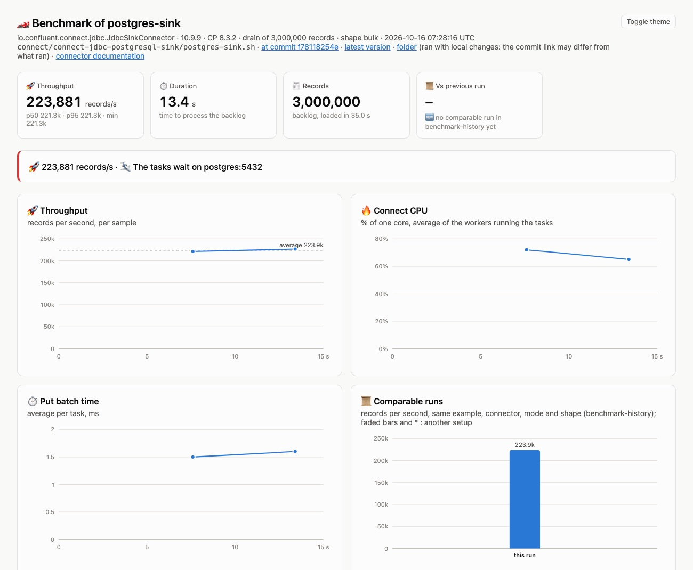

#### Compare connector versions

`--connector-tag` (repeat the flag) benchmarks several versions of the connector plugin one after the other. For each version: [playground update-version](https://kafka-docker-playground.io/#/playground%20update-version) `--connector-tag` (only the connect container is restarted, the connector and its offsets are kept), a check that the connector runs the requested version, an untimed warm-up drain (the worker JVM was restarted), then the benchmark. The original version is restored at the end, and the summary and the report compare the versions (one color per version, mean / min / max, delta with the first version). `--rounds 2` alternates the versions (A B A B), which shows a drift from one run to the next:

```bash
playground connector benchmark --nb-records 5000000 --connector-tag 10.9.7 --connector-tag 10.9.9 --rounds 2
```

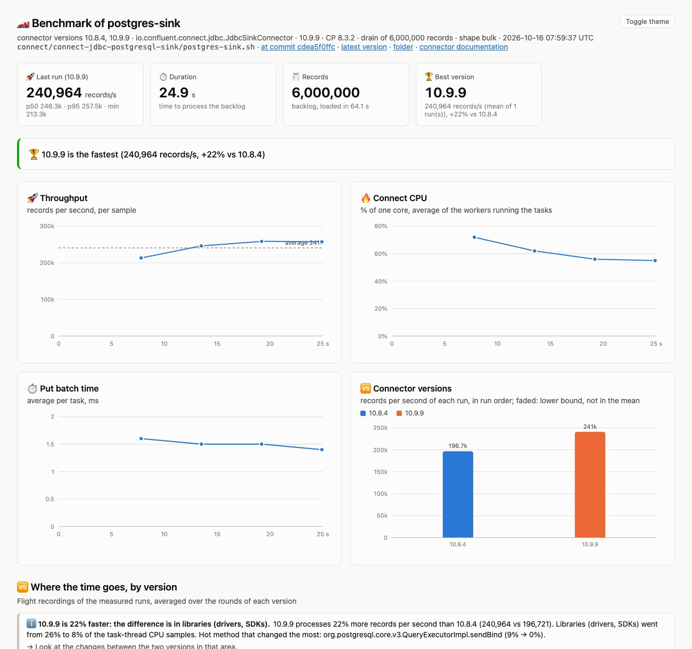

With the flight recorder (see below), the comparison report also shows where the time goes for each version: CPU by
layer and task time by state, with the change in points, and a finding that names what changed when a version is 5% or
more slower or faster.

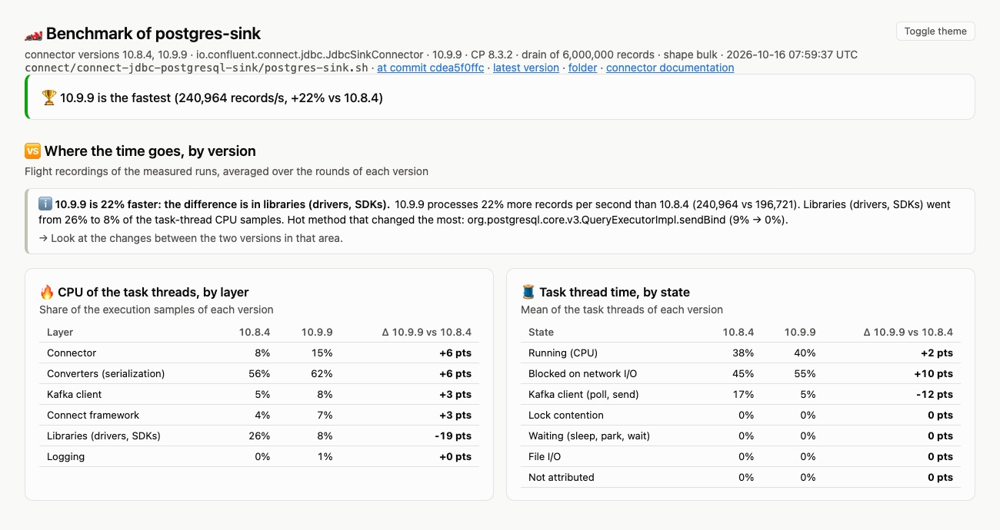

> [!WARNING]
> A downgrade or a major version change can be incompatible with the offsets or the config of the connector: the comparison stops at the first FAILED state.

Each result also records the setup it ran on, shown in the **Setup** section of the report: host (OS, CPU model, CPUs, memory), container engine and the resources given to it, connect image and whether it runs **emulated** (an amd64 image on an arm64 host is much slower), connect JVM and maximum heap, number of workers and brokers, environment, connector plugin version, and the connector configuration with secrets masked. The summary warns when the previous run was on a different setup, and the history chart shows runs of another setup faded. The report also links to the example on GitHub, at the commit it ran with and on the default branch (repro models link to the private repository of the `reproduction-models` submodule), and to the documentation of the connector (from the manifest of its plugin).

#### 🛩️ Where the time goes

The connect workers are recorded with [Java Flight Recorder](/reusables?id=%f0%9f%9b%a9%ef%b8%8f-flight-recorder) during the measure (the drain, or the steady measure after the warm-up). The recording runs over JMX: the Confluent images have no `jcmd`, and nothing is restarted. The summary lists the findings, and the report gets a **Where the time goes** section, the same analysis as [`playground analyze flight-recorder`](/playground%20analyze%20flight-recorder): is it the connector, the system behind it, Kafka, a lock? Which part of the pipeline uses the CPU?

```
   flight recorder        🔴 The tasks wait on postgres:5432.
                          ℹ️  Most of the CPU goes to conversion.
                          ℹ️  Allocation is high.
```

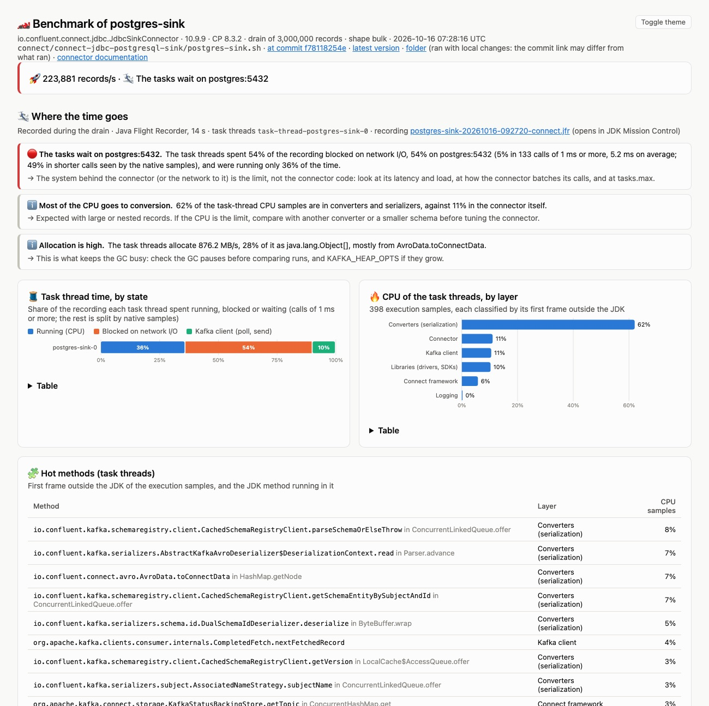

The `.jfr` files are kept in `--output-dir`, to open with JDK Mission Control or `playground analyze flight-recorder -f`. The recording costs a few % of throughput: `--no-flight-recorder` disables it, and the summary warns when the previous run was not recorded the same way.

#### 📊 Grafana

When the example runs with [Grafana](/how-to-use?id=%f0%9f%93%8a-enabling-jmx-grafana) (`--enable-jmx-grafana`, also enabled by `--enable-sql-datagen`), the benchmark marks the measure on the dashboards, so that you see the broker side, the JVM and the connector dashboards during the run:

* a region annotation over the window of the measure, with the throughput (`🏎️ benchmark of postgres-source (10.9.9): drain of 3000000 records, 225563.9 records/s`, tags `playground-benchmark`, the connector and its version), on the **Kafka Connect cluster** dashboard, the dashboard of the connector when there is one (**Debezium**, **Oracle CDC**, **Oracle XStream CDC**, **Mongo**), and the **Kafka cluster** dashboard. With `--connector-tag`, each version annotates its own run
* links to those dashboards at the time of the run in the summary and in the header of the HTML report (`📊 Grafana: Kafka Connect cluster · Kafka cluster`)

```
   grafana                http://localhost:3000/d/AEaSQ97mz?orgId=1&from=1792145306949&to=1792145491358
                          measure annotated on 2 dashboard(s): Kafka Connect cluster, Kafka cluster
```

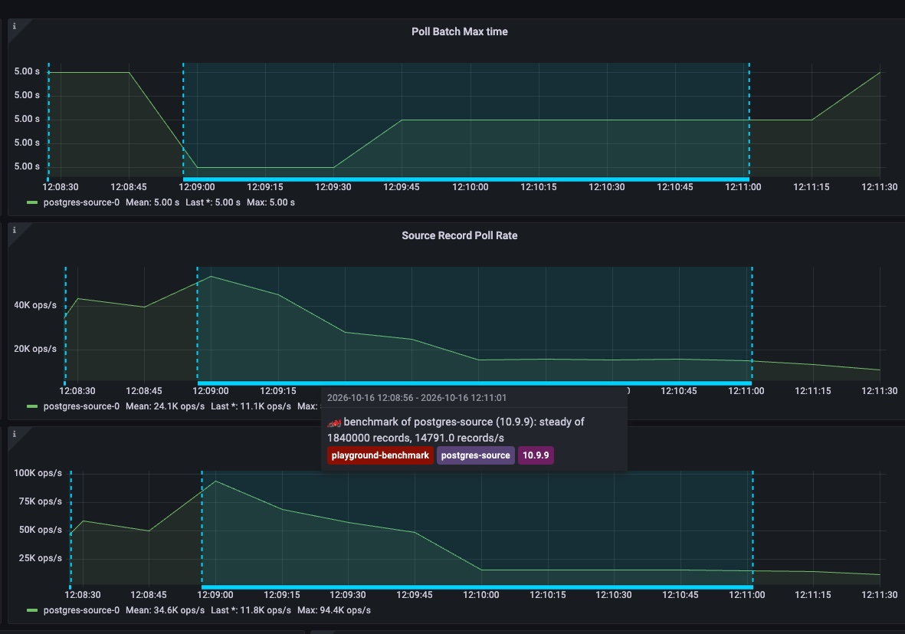

The benchmark does not start Grafana: start the example with it. Prometheus scrapes every 15 s, so a measure needs to last at least 45 s to show on the dashboards; the summary warns when it is shorter (`grafana has only N sample(s) during it`): increase `--nb-records`, or use `--mode steady --duration 2m`. The JMX exporter and the Grafana containers use some CPU: the summary also warns when the previous run was not measured the same way.

> [!NOTE]
> Everything runs on one docker host: the numbers are relative, compare runs on the same machine only. When the backlog is processed before the first sample, the throughput is only a lower bound (`≥`): increase `--nb-records` 10x. Fully managed connectors and the cfk environment are not supported yet.

### 🌪️ Databases: keep a load running with `--enable-sql-datagen`

For the JDBC, Debezium, Oracle CDC and XStream source examples (Oracle, MySQL, MariaDB, PostgreSQL, SQL Server, self-managed and fully managed), `--enable-sql-datagen` keeps rows coming into the database once the example is done, while you watch the connector (Grafana is enabled with it):

```bash
playground run -f postgres.sh --enable-sql-datagen
SQL_DATAGEN_DURATION=30 SQL_DATAGEN_SESSIONS=10 playground run -f cdc-oracle19-pdb-table.sh --enable-sql-datagen
```

After the example succeeded, `playground run` starts the `benchmark-load.bash` of the example (the load of [playground connector benchmark](/reusables?id=%e2%8f%b1%ef%b8%8f-benchmark-a-connector), on the table its connector reads: `CUSTOMERS` for most examples) in stream mode, one row per transaction, in `SQL_DATAGEN_SESSIONS` parallel sessions (default 5: concurrent transactions, as on a busy database), for `SQL_DATAGEN_DURATION` minutes (default 10). It logs the rows inserted every 30 seconds, then stops the sessions at the end of their current batch:

```
🌪️ injecting rows with benchmark-load.bash for 1 minute(s): 5 session(s), one row per transaction
🌪️ 29500 rows inserted in 31s (951 rows/s)
🌪️ 63000 rows inserted in 61s (1032 rows/s)
🌪️ done: 63600 rows inserted in 61s by 5 session(s)
```

A reproduction model gets the load of its example from `playground repro bootstrap`, and can use a table of its own: see [A table of your own](/reusables?id=a-table-of-your-own-reproduction-models).

> [!TIP]
> To measure the connector rather than keep it busy, use [playground connector benchmark](/reusables?id=%e2%8f%b1%ef%b8%8f-benchmark-a-connector): same loads, with `--sessions` for parallel sessions.

